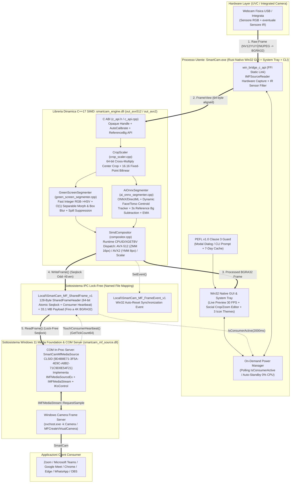

#  SmartCam — Suite Nativa di Elaborazione Video Real-Time & Virtual Camera per Windows 11

[](LICENSE)

> 🌐 **Lingua / Language:** **🇮🇹 Leggi in Italiano (`README.md`)** | **[🇬🇧 Read in English (`README_EN.md`)](README_EN.md)**  
> 📜 **Documenti Legali & SDK:** [`LICENSE` (Master EN)](LICENSE) • [`LICENSE.it` (Traduzione IT)](LICENSE.it) • [`NOTICE.md`](NOTICE.md) • [`AI_INSTRUCTIONS.md`](AI_INSTRUCTIONS.md) • **[`🧩 Guida SDK Plugin (how-to-make-a-plugin.md)`](how-to-make-a-plugin.md)**

| <br/>**💠 Cyber Lens** *(Default, ID `101`)* | <br/>**🟢 Emerald Cam** *(Studio Broadcast, ID `102`)* | <br/>**🟣 Neon Iris** *(Creator AI, ID `103`)* |
| :---: | :---: | :---: |
| Tema Ciano/Blu con ottica vettoriale | Tema Verde Smeraldo per regia live | Tema Viola/Magenta ad alto contrasto |

---

## 📑 Indice dei Contenuti (Struttura a 3 Livelli)

1. [⚡ LIVELLO 1 — Spiegazione Breve (Cos'è SmartCam in 30 Secondi)](#-1-spiegazione-breve-cosè-smartcam-in-30-secondi)
2. [🍌 LIVELLO 2 — Tutorial "A Prova di Scimmia" (Per chi non ha esperienza col PC)](#-2-tutorial-a-prova-di-scimmia-per-chi-non-ha-la-minima-esperienza-con-un-pc)
3. [🧠 LIVELLO 3 — Manuale Esteso per Smanettoni, Architetti & Sviluppatori (Deep-Dive Tecnico)](#-3-manuale-esteso-per-smanettoni-architetti--sviluppatori-deep-dive-tecnico)
   - [3.1 Architettura Completa del Sistema & Albero del Repository](#31-architettura-completa-del-sistema--albero-del-repository)
   - [3.2 Pipeline Matematica, Accelerazione GPU (`Vulkan`/`OpenCL`/`CUDA`/`ROCm`), SIMD (`AVX-512`/`AVX2`) & Benchmark Intelligente](#32-pipeline-matematica-accelerazione-gpu-vulkanopenclcudarocm-simd-avx-512avx2--benchmark-intelligente)
   - [3.3 Sistema di Plugin Modulari & Fotocamera Smartphone (`how-to-make-a-plugin.md`)](#33-sistema-di-plugin-modulari--fotocamera-smartphone-how-to-make-a-pluginmd)
   - [3.4 Sottosistema Windows 11 Media Foundation & Linux `AppImage` (`v4l2loopback`)](#34-sottosistema-windows-11-media-foundation--linux-appimage-v4l2loopback)
   - [3.5 Impostazioni Avanzate, CLI Flag e File di Configurazione (`config/default_config.yaml`)](#35-impostazioni-avanzate-cli-flag-e-file-di-configurazione-configdefault_configyaml)
   - [3.6 Compilazione da Sorgenti, Unit Test e Packaging (`makeInstaller` / `makeAppImage`)](#36-compilazione-da-sorgenti-unit-test-e-packaging-makeinstaller--makeappimage)
   - [3.7 Guida per Sviluppatori & Agenti AI Multi-OS](#37-guida-per-sviluppatori--agenti-ai-multi-os)

---

# ⚡ 1. SPIEGAZIONE BREVE (Cos'è SmartCam in 30 Secondi)

**SmartCam** trasforma istantaneamente qualsiasi normale webcam USB, integrata nel portatile o **fotocamera dello smartphone (Wi-Fi / USB)** in una **telecamera da studio professionale**, rendendola visibile nativamente dentro **Zoom, Microsoft Teams, Google Meet, Chrome, Edge, WhatsApp Desktop, Discord e OBS Studio** con il nome dispositivo **`"SmartCam"`** (su Windows 11 e Linux).

### Cosa fa in pratica?
- **🎨 Nuova UX Studio Ergonomica e Zero Sovrapposizioni:** interfaccia widescreen ordinata con **Header di Navigazione Superiore** (`🧩 Plugin`, `⚡ Prestazioni, GPU & Benchmark`, `⚙️ Calibrazione`, `🧭 Guida`, `📜 PEFL`, `🔽 Tray` + selettore rapido delle 3 icone), **Grande Anteprima Video Centrale** con pillola telemetrica live sovrapposta in semitrasparenza (`1440x1080 (4:3) • 30 FPS • Backend: AVX-512 / Vulkan • AI: ON`), e **2 Righe di Controlli Rapidi** sotto il video sempre allineate e ariose!
- **💧 Sfoca lo sfondo dinamicamente o lo sostituisce con l'Intelligenza Artificiale** (seguendo i tuoi movimenti in tempo reale senza avere un telo verde dietro la schiena) oppure trasforma la tua stanza in un **📸 Telo Virtuale ("Cattura Sfondo Reale 3s")** o rimuove un **🟩 Telo Verde (Chroma Key)** con calibrazione automatica in un solo clic.
- **🧩 Sistema di Plugin Attivabili/Disattivabili dall'Utente (`Modale Gestione Plugin`):** abilita o disabilita in 1 clic i plugin integrati o esterni (`.dll`/`.so` in `plugins/`):
  1. **📱 Fotocamera Smartphone (Wi-Fi / USB):** usa la fotocamera ad alta definizione del tuo telefono Android/iPhone come webcam principale di SmartCam (via IP Webcam HTTP/MJPEG, RTSP o tethering USB)!
  2. **🌐 WebRTC / RTSP Network Stream:** riceve flussi video di rete da telecamere IP o regia remota.
  3. **🎨 Studio Color & Denoise Enhancer:** miglioramento automatico del contrasto, tono pelle e riduzione rumore in condizioni di scarsa luce.
  4. **📜 Teleprompter Overlay:** sovrimpressione discreta di note/script per presentazioni e lezioni.
  *(Scopri come creare un tuo plugin personalizzato in C/C++ o Rust nella guida **[`how-to-make-a-plugin.md`](how-to-make-a-plugin.md)**!).*
- **⚡ Centro Prestazioni: Controllo Totale CPU vs GPU (`Vulkan`, `OpenCL`, `CUDA`, `ROCm`), Scelta AVX (`Auto`, `AVX-512`, `AVX2`, `Scalare`) & Toggle AI (`AI Attiva` vs `AI Disattivata`) + Benchmark Automatico:**
  - Scegli liberamente se elaborare su **CPU** o **GPU** (`Vulkan`, `OpenCL`, `NVIDIA CUDA`, `AMD ROCm`, `Auto`), quale set di istruzioni vettoriali **AVX** utilizzare (`Auto`, `AVX-512`, `AVX2`, `Scalare / Senza AVX`) e se tenere l'**AI Attiva** (massima qualità scontorno) o **AI Disattivata** (modalità ultra-leggera).
  - **Benchmark Hardware Intelligente ("Una Sola Volta per Hardware"):** al primo avvio su un nuovo PC, SmartCam esegue un micro-benchmark rapido (~0.4 secondi), calcola i punteggi (`Pt`), gli FPS massimi e il carico stimato per ogni combinazione, evidenzia con il badge **`⭐ CONSIGLIATO PER IL TUO HARDWARE`** il profilo ottimale e memorizza il risultato su disco (`config/hardware_benchmark.yaml`) legato all'impronta dell'hardware così **non ripete il test agli avvii successivi** (ma puoi sempre rilanciarlo manualmente dal pulsante **`🚀 Esegui Test Prestazioni Ora`** o dal menu della System Tray!).
- **🖼️ Modale Unificato Galleria Sfondi, Caricamento Foto & Ritaglio "Stile Social":** il pulsante **`🖼️ Scegli / Ritaglia Sfondo...`** apre la galleria con le **4 miniature visive a colori dei Preset Studio HD** (`🏢 Studio Blu`, `🪵 Ufficio Caldo`, `☀️ Loft Chiaro`, `🏛️ Executive Dark`), il caricamento foto dal PC e l'editor interattivo **Drag & Pan + Zoom (100%–400%)**.
- **📐 Barra dei 4 Menu a Tendina Interattivi:** scegli in un clic **Formato** (`16:9`, `4:3`, `1:1`, `9:16`), **Definizione** (`1080p Full HD` .. `240p`), **Fluidità** (`60` .. `10 FPS`) e **Motore Scontorno** (`Auto`, `Sagoma AI`, `Differenza Sfondo`) + **`−` `Tolleranza` `+`**.
- **🕵️ Evita per te la "trappola" delle webcam a infrarossi** e offre **🎨 3 Icone Vettoriali Selezionabili (`Cyber Lens`, `Emerald Cam`, `Neon Iris`)**.

### Perché è diversa dai soliti programmi?
- **🚀 100% Nativa (Rust + C++17 SIMD & Multi-GPU, Zero Python, Zero Finestra DOS):** disponibile sia per **Windows 11 (`SmartCam_Setup_v1.0.0_x64.exe`)** sia per **Linux (`SmartCam-x86_64.AppImage`)**.
- **🔋 0% CPU quando non sei in videochiamata (On-Demand "Set & Forget"):** quando chiudi la finestra e non stai facendo chiamate, SmartCam spegne fisicamente la webcam (anche il LED luminoso si spegne!). Appena apri Zoom, Teams o Meet, la webcam si riaccende da sola in meno di mezzo secondo.

### 📜 Sintesi della Licenza — PEFL v1.0 (Personal and Educational Free License)
Tutto il codice sorgente, gli eseguibili e gli installer di **SmartCam** sono rilasciati sotto licenza **[Personal and Educational Free License (PEFL) v1.0](https://github.com/RubensRainelli/pefl-license-spec)** (consulta [`LICENSE`](LICENSE), [`LICENSE.it`](LICENSE.it) e [`NOTICE.md`](NOTICE.md)):
- 🟢 **100% GRATUITA per Uso Personale, Domestico, Didattico, Scolastico, Accademico e No-Profit (Terzo Settore / ONLUS).**
- 🔴 **VIETATO l'Uso Aziendale, Commerciale, Professionale o Governativo** senza preventiva autorizzazione scritta dell'autore (**Rubens Rainelli**) e pagamento del relativo canone di licenza.
- 🔴 **Luoghi di culto ed enti religiosi** sono esplicitamente esclusi dall'Uso Personale ed equiparati all'Uso Aziendale.
- **Contatti Autore per Licenze Commerciali / Enterprise:**
  - **Autore:** Rubens Rainelli
  - **Email:** [rubens@rainelli.it](mailto:rubens@rainelli.it)
  - **GitHub:** [https://github.com/RubensRainelli/](https://github.com/RubensRainelli/)
  - **Telefono:** (+39) 342 811 5882

---

# 🍌 2. TUTORIAL "A PROVA DI SCIMMIA" (Per chi non ha la minima esperienza con un PC)

Non capisci nulla di computer? Niente paura! Non devi scrivere nessun comando né toccare impostazioni strane. Segui questi **3 semplicissimi passi** e in **un minuto** avrai finito.

### 🟢 Passo 1: Installa con 2 clic
1. Apri la cartella **`dist/`** (oppure la cartella dove hai scaricato il programma) e fai **doppio clic** col tasto sinistro del mouse sul file **`SmartCam_Setup_v1.0.0_x64.exe`** (su Linux ti basta avviare **`SmartCam-x86_64.AppImage`**).
2. Si aprirà una finestra: metti la spunta sulla casellina **"Accetto i termini della licenza PEFL v1.0..."** e clicca sul grande bottone blu **"🚀 Installa SmartCam Ora"**.
3. *(Nota bene)* Se Windows fa comparire una finestrella chiedendoti *"Vuoi consentire a questa app di apportare modifiche al dispositivo?"*, clicca tranquillamente su **"Sì"** (serve solo per aggiungere la nuova telecamera **`SmartCam`** a Windows).

---

### 🪞 Passo 2: Guardati allo specchio, scegli lo sfondo, i Plugin o il Benchmark!
Appena finita l'installazione, **SmartCam** si apre da sola e **vedi subito la tua faccia in diretta** nel grande riquadro centrale, con tutti i dati in un elegante badge trasparente in alto a destra nel video e due righe pulitissime di controlli sotto!

- **Vuoi sfocare la stanza o mettere un ufficio elegante dietro di te?**  
  - Sotto il video (Riga 1), clicca su **💧 Sfoca Sfondo** o su **🤖 Sfondo Virtuale**.
  - Clicca su **`🖼️ Scegli / Ritaglia Sfondo...`** per aprire la Galleria con le **4 miniature Studio HD**, caricare una foto dal PC o ritagliarla/zoomarla col mouse!
  - Clicca su **`📸 Cattura Sfondo Reale (3s)`**, spostati per 3 secondi lasciando la stanza vuota e torna a sederti per attivare il **Telo Verde Virtuale Anti-LED**!
- **Vuoi usare il tuo Smartphone come Webcam HD o attivare i Filtri?**  
  - Clicca in alto su **`🧩 Plugin (Telefono & Filtri)`**: si apre la finestra dei Plugin dove puoi attivare con un clic **`[ ✅ ATTIVO ]`** il plugin **`📱 Fotocamera Smartphone (Wi-Fi / USB)`**, inserire l'indirizzo IP della fotocamera del telefono (es. `http://192.168.1.100:8080/video`) o la modalità USB, oppure attivare **`🎨 Studio Color & Denoise Enhancer`**!
- **Vuoi sapere qual è la modalità più veloce per il tuo PC (CPU vs GPU Vulkan/OpenCL/CUDA/ROCm e AVX)?**  
  - Clicca in alto su **`⚡ Prestazioni, GPU & Benchmark`**: vedrai la classifica delle prestazioni misurate sul tuo PC con il badge **`⭐ CONSIGLIATO PER IL TUO HARDWARE`**. Puoi cliccare **`✅ Applica Configurazione Consigliata`** oppure scegliere manualmente tra **CPU / Vulkan / OpenCL / CUDA / ROCm**, **AVX-512 / AVX2 / Scalare** e **AI Attiva / AI Disattivata**!
- **Vuoi cambiare Formato, Definizione (`1080p..240p`) o Fluidità (`60..10 FPS`)?**  
  - Usa i **4 menu a tendina allineati sulla Riga 2 sotto il video** (`📺 Formato`, `🎞️ Definizione`, `⏱️ Fluidità`, `🧠 Scontorno`).

---

### 📞 Passo 3: Chiudi pure con la "X" e apri Zoom / Teams / Meet
1. Quando ti piace come ti vedi, **puoi tranquillamente chiudere la finestra di SmartCam cliccando sulla `X` in alto a destra**.
2. **Il programma NON si spegne:** va a "dormire" silenziosamente vicino all'orologio di Windows (in basso a destra dello schermo) e spegne la lucina della tua webcam così non consuma né corrente né batteria.
3. Ora apri il programma che usi per le videochiamate (**Zoom, Microsoft Teams, Google Meet sul browser, o WhatsApp**), vai nelle impostazioni del video dove scegli la telecamera e seleziona:
   > 🎥 **`SmartCam`**
4. **Magia!** Appena entri in chiamata, la tua webcam si accenderà da sola con tutti gli effetti che hai scelto, e quando chiuderai la videochiamata tornerà a dormire da sola!

---

### 🆘 SOS Problemi Comuni ("Aiuto, non funziona!")

- ❓ **"Mi vedo tutto in bianco e nero, con colori strani o l'immagine lampeggia!"**  
  👉 Molti portatili hanno due telecamere: una normale a colori e una "a infrarossi" che serve a Windows solo per riconoscerti al buio quando sblocchi il PC. Se hai scelto quella a infrarossi, SmartCam ti mostra un **avviso giallo** sopra il video: ti basta premere le frecce **◀ / ▶** accanto a **Fotocamera in uso** in alto per passare alla fotocamera a colori!
- ❓ **"Vedo il riquadro tutto nero / Windows blocca la telecamera!"**  
  👉 A volte Windows 11 blocca per privacy tutte le webcam. Premi il bottone **"🔓 Sblocca Permessi Cam"** dentro SmartCam: ti aprirà direttamente la pagina giusta di Windows dove devi solo spostare l'interruttore su **"Attivato"**. Controlla anche di non avere già un altro programma aperto che sta usando la webcam in esclusiva.
- ❓ **"Voglio vedere la differenza tra la mia webcam normale e SmartCam una accanto all'altra"**  
  👉 Clicca sul bottone **"🌐 Test 2 Webcam Web"** dentro SmartCam: si aprirà una pagina nel tuo browser che ti mostra a sinistra la webcam normale e a destra **`SmartCam`**, con anche una tendina scorrevole per confrontarle dal vivo!

---

# 🧠 3. MANUALE ESTESO PER SMANETTONI, ARCHITETTI & SVILUPPATORI (Deep-Dive Tecnico)

Questa sezione documenta in dettaglio l'architettura interna, gli algoritmi matematici in virgola fissa e SIMD, il tracciamento dinamico del soggetto con sottrazione dello sfondo di riferimento, l'editor di crop/zoom delle immagini di sfondo, il protocollo IPC lock-free condiviso con il Windows Camera Frame Server, i flag da riga di comando e il flusso di build multi-variante.

---

## 3.1 Architettura Completa del Sistema & Albero del Repository

SmartCam adotta un'architettura **100% nativa e modulare** che separa rigorosamente il motore matematico di elaborazione frame (`common/engine/`, scritto in **C++17** con intrinseci SIMD senza alcun header dipendente dal sistema operativo) dai sottosistemi specifici di piattaforma (`platforms/windows/`) e dal controller GUI/CLI/Tray scritto in **Rust** (`app/`, compilato con `#![windows_subsystem = "windows"]` per eliminare qualsiasi finestra console superflua).

### Diagramma Architetturale End-to-End



### Albero Completo dei File del Repository

```text
SmartCam/
├── LICENSE                         # Testo ufficiale Licenza PEFL v1.0 (Master in Inglese)
├── LICENSE.it                      # Traduzione ufficiale Italiana Licenza PEFL v1.0
├── NOTICE.md                       # Riepilogo ufficiale condizioni d'uso PEFL v1.0
├── AI_INSTRUCTIONS.md              # Direttive vincolanti per Agenti AI (Clausola 3 PEFL)
├── README.md                       # Documentazione principale a 3 livelli (Italiano)
├── README_EN.md                    # Documentazione completa a 3 livelli (Inglese)
├── SmartCam.exe                    # Eseguibile Desktop, CLI & System Tray nativo (Rust Win32, Zero Console)
├── makeInstaller.bat / .ps1        # Builder "One-Click" per generare Installer e ZIP portatile in dist/
├── assets/                         # Icone vettoriali multi-risoluzione e sfondi studio HD
│   ├── icons/
│   │   ├── smartcam_logo.png       # Logo principale ad alta risoluzione
│   │   ├── smartcam_cyber_lens.ico # Icona Tema 1: Cyber Lens (ID risorsa 101)
│   │   ├── smartcam_emerald_cam.ico# Icona Tema 2: Emerald Cam (ID risorsa 102)
│   │   └── smartcam_neon_iris.ico  # Icona Tema 3: Neon Iris (ID risorsa 103)
│   └── backgrounds/                # 4 Preset Studio 1920x1080 integrati
│       ├── preset_1_studio_blue.jpg
│       ├── preset_2_warm_office.jpg
│       ├── preset_3_minimal_loft.jpg
│       └── preset_4_dark_executive.jpg
├── config/                         # File di configurazione e validazione schema
│   ├── default_config.yaml         # Configurazione runtime predefinita (input, framing, HSV, AI, crop, icona)
│   └── config.schema.json          # JSON Schema Draft 2020-12 per validazione rigorosa
├── common/                         # CORE ENGINE CONDIVISO (100% Platform-Agnostic, ZERO header OS)
│   ├── include/                    # Contratti astratti C++17 e strutture dati memoria
│   │   ├── frame_buffer.h          # FrameView e AlignedFrameBuffer (allineamento a 64 byte per AVX-512)
│   │   ├── icamera_source.h        # Interfaccia pura ICameraSource per acquisizione video
│   │   ├── ivirtual_camera.h       # Interfaccia pura IVirtualCamera per iniezione frame nel sink OS
│   │   └── isegmenter.h            # Interfaccia ISegmenter e configurazioni per maschere alpha
│   ├── engine/                     # Implementazione algoritmica C++17 + C ABI
│   │   ├── CMakeLists.txt          # Configurazione CMake multi-target (static, shared DLL, unit test)
│   │   ├── c_api.h / c_api.cpp     # C ABI esportata (smartcam_engine_create, process_frame, set_reference_background...)
│   │   ├── crop_scaler/            # Ritaglio distorsion-free e resampling bilineare 16.16
│   │   │   └── crop_scaler.h/.cpp
│   │   ├── compositor/             # Alpha blending vettorializzato (AVX-512, AVX2, Scalar) + Blur/Solid/Image
│   │   │   └── compositor.h/.cpp
│   │   └── segmentation/           # Segmentatori cromatici e neurali
│   │       ├── green_screen_segmenter.h/.cpp  # Chroma key HSV intero, morfologia O(1), spill e AutoCalibrate
│   │       └── ai_onnx_segmenter.h/.cpp       # Selfie segmentation ONNX + Dynamic Subject Tracker + Reference Bg
│   ├── plugins/                    # Estensioni di acquisizione video remota
│   │   └── webrtc_rtsp_stub.cpp    # Stub architetturale per flussi di rete WebRTC / RTSP
│   └── tests/                      # Suite di test automatici C++17
│       └── test_engine_cpp.cpp     # Verifica bit-exact su Crop, HSV, AutoCalibrate, AI Tracking e SIMD
├── platforms/                      # SOTTOSISTEMI SPECIFICI PER SISTEMA OPERATIVO
│   ├── windows/                    # *** TARGET PRIMARIO: WINDOWS 11 (x86_64) ***
│   │   ├── CMakeLists.txt          # Build CMake per smartcam_mf_source.dll e bridge Windows
│   │   ├── win_bridge_c_api.h/.cpp # Bridge C ABI linkato staticamente a Rust (Capture + Sink + IR Detect)
│   │   ├── ipc/                    # Trasporto frame a memoria condivisa lock-free
│   │   │   └── shared_frame_ipc.h  # SharedFrameHeader (128 byte), Seqlock atomico 64-bit e Heartbeat
│   │   ├── capture/                # Cattura webcam a bassa latenza tramite Media Foundation
│   │   │   └── mf_camera_capture.h/.cpp # IMFSourceReader, decodifica in BGRA32 e rilevamento sensori IR
│   │   ├── drivers/                # Driver Virtual Camera user-mode Windows 11
│   │   │   ├── mf_virtual_camera.h/.cpp     # Wrapper MFCreateVirtualCamera e sink producer
│   │   │   ├── mf_media_source_com.h/.cpp   # Server COM IMFMediaSourceEx / IMFMediaStream ("SmartCam")
│   │   │   └── smartcam_mf_source.def       # Esportazioni COM (DllGetClassObject, DllRegisterServer...)
│   │   ├── scripts/                # Automazione PowerShell e Batch
│   │   │   ├── make_installer.ps1           # Generatore pacchetti redistribuibili e compilatore Setup C#
│   │   │   ├── register_virtual_camera.ps1  # Registrazione COM + verifica Camera Frame Server
│   │   │   ├── start_smartcam.ps1 / .bat    # Script di lancio con guardia PEFL v1.0
│   │   │   └── start_web_preview.ps1        # Avvio server HTTP locale per testbench 2 webcam
│   │   └── build/                  # Directory di compilazione dual-variant
│   │       ├── build_windows.ps1   # Script di build per le varianti AVX2 e AVX-512
│   │       ├── out_avx2/           # Binari compilati con /arch:AVX2 (-mavx2 -mfma), 0 istruzioni ZMM
│   │       └── out_avx512/         # Binari compilati con /arch:AVX512 (-mavx512f -mavx512bw -mavx512dq -mavx512vl)
│   ├── linux/                      # [PREDISPOSIZIONE] Stub v4l2loopback (/dev/videoX)
│   └── macos/                      # [PREDISPOSIZIONE] Stub CoreMediaIO Camera Extension
├── app/                            # APPLICAZIONE DESKTOP NATIVA IN RUST + WEB TESTBENCH
│   ├── Cargo.toml                  # Manifesto Cargo (LicenseRef-PEFL-1.0)
│   ├── build.rs                    # Script di build per compilazione bridge Win32/MF e risorse icone RC
│   ├── smartcam.rc                 # Resource script Win32 con le 3 icone incorporate (ID 101, 102, 103)
│   ├── src/
│   │   ├── main.rs                 # Entry-point (#![windows_subsystem = "windows"]), parser CLI e avvio GUI
│   │   ├── gui.rs                  # Interfaccia Win32 GDI, Editor Crop/Zoom Sfondo, Cattura 3s, Icon Switcher
│   │   ├── engine_bridge.rs        # Caricamento dinamico FFI di smartcam_engine.dll + Crop/Zoom Social
│   │   ├── win32_ffi.rs            # Binding FFI Win32, GDI+ (gdiplus.dll) e File Dialog (comdlg32.dll)
│   │   ├── diagnostics.rs          # Diagnostica hardware, filtro webcam IR e stato COM
│   │   ├── config.rs               # Parser/Serializer YAML zero-dependency per default_config.yaml
│   │   └── pefl_guard.rs           # Guardia di conformità PEFL v1.0 (Clausola 3) con cache a 7 giorni
│   └── web_preview/                # Testbench Web Side-by-Side (Confronto 2 Webcam + Wipe Slider)
│       └── index.html
└── dist/                           # Artefatti redistribuibili generati da .\makeInstaller
    ├── SmartCam_Setup_v1.0.0_x64.exe     # Installer grafico single-file con disinstallatore integrato
    ├── SmartCam_Portable_v1.0.0_x64.zip  # Pacchetto portatile pronto all'uso
    └── SHA256SUMS.txt                    # Manifesto crittografico SHA-256 dei binari
```

---

## 3.2 Pipeline Matematica e Vettorializzazione SIMD (`common/engine/`)

Tutti i buffer video interni utilizzano [`AlignedFrameBuffer`](file:///c:/Users/Rubens/Dev/SmartCam/common/include/frame_buffer.h), allocato con allineamento di memoria garantito a **64 byte** (`kSimdAlignment = 64`) e *row stride* multiplo di 64 byte per massimizzare il throughput delle linee di cache L1/L2 e dei caricamenti vettoriali a 512 bit.

### 1. `CropScaler` & Social Background Crop/Zoom ([`common/engine/crop_scaler/`](file:///c:/Users/Rubens/Dev/SmartCam/common/engine/crop_scaler/crop_scaler.cpp), [`app/src/engine_bridge.rs`](file:///c:/Users/Rubens/Dev/SmartCam/app/src/engine_bridge.rs))
Risolve alla radice il problema delle webcam grandangolari `16:9` che schiacciano o stirano il volto quando vengono forzate in un contenitore `4:3` o `1:1`:
- **Calcolo del Rettangolo di Center Crop (`ComputeCenterCropRect`):** confronta il rapporto d'aspetto sorgente $W_{\text{src}} / H_{\text{src}}$ con il target $A_w / A_h$ usando una **moltiplicazione incrociata intera a 64-bit** esente da errori di arrotondamento floating-point:
  $$\text{lhs} = W_{\text{src}} \cdot A_h, \qquad \text{rhs} = H_{\text{src}} \cdot A_w$$
  - Se $\text{lhs} > \text{rhs}$ (sorgente più larga del target, es. input `1920x1080` `16:9` $\to$ target `4:3`), ritaglia orizzontalmente forzando la larghezza a un numero pari (`target_w &= ~1u`) per la compatibilità con gli encoder YUV/NV12:
    $$W_{\text{crop}} = \left\lfloor \frac{H_{\text{src}} \cdot A_w}{A_h} \right\rfloor \ \& \ \sim 1, \qquad H_{\text{crop}} = H_{\text{src}}, \qquad X_0 = \frac{W_{\text{src}} - W_{\text{crop}}}{2}, \qquad Y_0 = 0$$
  - **Caso nominale `1920x1080` (16:9) $\to$ `1440x1080` (4:3) a Costo Zero:** poiché la ROI di ritaglio calcolata ($1440 \times 1080$, con offset $X_0 = 240$) coincide esattamente con le dimensioni di output ($1440 \times 1080$), `ResizeBilinearROI` attiva il **fast-path 1:1** eseguendo un `std::memcpy` diretto per scanline (`row_bytes = 1440 * 4 = 5760` byte) senza alcuna interpolazione, preservando la nitidezza ottica nativa del sensore.
- **Ritaglio & Zoom Stile Profilo Social per Immagini di Sfondo (`compute_social_crop_rect`):** dato uno sfondo sorgente $(W_{\text{bg}}, H_{\text{bg}})$, un formato di destinazione $(W_{\text{out}}, H_{\text{out}})$, un fattore di ingrandimento $Z \in [1.0, 4.0]$ e coordinate di pan normalizzate $(P_x, P_y) \in [0, 1]^2$, calcola la finestra massimale con lo stesso aspect ratio dell'output divisa per $Z$:
  $$W_{\text{win}} = \frac{W_{\text{base}}}{Z}, \qquad H_{\text{win}} = \frac{H_{\text{base}}}{Z}, \qquad X_0 = \lfloor (W_{\text{bg}} - W_{\text{win}}) \cdot P_x \rfloor, \qquad Y_0 = \lfloor (H_{\text{bg}} - H_{\text{win}}) \cdot P_y \rfloor$$
- **Interpolazione Bilineare in Virgola Fissa `16.16` (`ResizeBilinearROI`):** quando è richiesto anche il ridimensionamento (o per l'upsampling della maschera AI da `256x144` a `1440x1080`), le coordinate sorgente sono calcolate con fattori di scala interi a 32-bit:
  $$\text{scale}_x = \frac{W_{\text{roi}} \ll 16}{W_{\text{dst}}}, \qquad \text{scale}_y = \frac{H_{\text{roi}} \ll 16}{H_{\text{dst}}}$$
  I pesi frazionari a 8 bit $w_x, w_y \in [0, 255]$ e i complementi $\bar{w}_x = 256 - w_x, \bar{w}_y = 256 - w_y$ producono i 4 coefficienti bilineari $w_{00}, w_{10}, w_{01}, w_{11}$ la cui somma è esattamente $256 \times 256 = 65536 = 2^{16}$, consentendo la normalizzazione finale tramite un semplice bit-shift `>> 16`:
  $$I_{\text{out}}(x, y) = \bigl( P_{00} \cdot \bar{w}_x \bar{w}_y + P_{10} \cdot w_x \bar{w}_y + P_{01} \cdot \bar{w}_x w_y + P_{11} \cdot w_x w_y \bigr) \gg 16$$

### 2. `GreenScreenSegmenter` & Auto-Calibrazione ([`common/engine/segmentation/green_screen_segmenter.cpp`](file:///c:/Users/Rubens/Dev/SmartCam/common/engine/segmentation/green_screen_segmenter.cpp))
Pipeline cromatica deterministica a latenza sub-millisecondo progettata per fondali verdi illuminati anche in modo non uniforme:
- **Conversione Intera Rapida `RgbToHsvFast`:** converte ogni pixel $(R, G, B) \in [0, 255]^3$ nello spazio cilindrico $(H, S, V)$ con $H \in [0, 180]$ (convenzione OpenCV-compatibile per entrare in un singolo `uint8_t`) e $S, V \in [0, 255]$ usando esclusivamente aritmetica intera:
  $$V = \max(R, G, B), \qquad \Delta = V - \min(R, G, B), \qquad S = \begin{cases} \lfloor 255 \cdot \Delta / V \rfloor & \text{se } V > 0 \\ 0 & \text{se } V = 0 \end{cases}$$
  Il pixel viene classificato come sfondo (`mask = 0`) se $(H \in [H_{\min}, H_{\max}]) \land (S \in [S_{\min}, S_{\max}]) \land (V \in [V_{\min}, V_{\max}])$, altrimenti come soggetto (`mask = 255`).
- **Apertura Morfologica Separabile $O(1)$ (`MorphologicalOpen`):** rimuove i puntini isolati di rumore sul telo verde senza la complessità quadratica $O(K^2)$ di un filtro 2D classico. Applica una **Erosione 1D orizzontale + 1D verticale** ($\min$ su finestra $[-r, +r]$) seguita da una **Dilatazione 1D orizzontale + 1D verticale** ($\max$ su finestra $[-r, +r]$).
- **Filtro Soft-Edge a Finestra Scorrevole $O(1)$ (`SeparableSoftBlur`):** esegue **due passate consecutive** di un filtro Box 1D separabile (orizzontale + verticale) con accumulatore scorrevole (`sum += src[right] - src[left]`). Per il Teorema del Limite Centrale, due passate di box filter approssimano una campana Gaussiana con costo computazionale rigorosamente indipendente dal raggio `blur_radius` ($O(1)$ operazioni per pixel).
- **Soppressione dell'Alone Verde (`SuppressGreenSpill`):** neutralizza la luce verde riflessa dal telo su capelli, spalle e contorni della pelle. Per ogni pixel con $\alpha > 0$, calcola la media dei canali Rosso e Blu $\overline{RB} = (R + B) \gg 1$; se $G > \overline{RB}$, riduce l'eccesso di verde in virgola fissa `8.8` (`strength_fp` $\in [0, 256]$):
  $$G_{\text{new}} = G - \bigl( (G - \overline{RB}) \cdot \text{strength}_{\text{fp}} \gg 8 \bigr)$$
- **Algoritmo Statistico `AutoCalibrate` (1-Clic & Contagocce):**
  - Se invocato tramite clic del mouse sull'anteprima video (`sample_x >= 0, sample_y >= 0`), campiona una patch quadrata di raggio $\max(4, \min(W, H)/32)$ attorno al punto cliccato.
  - Se invocato tramite il pulsante automatico (`sample_x = -1, sample_y = -1`), campiona due patch rettangolari negli angoli superiori sinistro e destro dello sfondo.
  - Sui campioni raccolti calcola **mediana** ($\tilde{\mu}_H, \tilde{\mu}_S, \tilde{\mu}_V$), **media** ($\mu$), **deviazione standard** ($\sigma_H, \sigma_S, \sigma_V$) e i **percentili al 5% e 95%** ($P_{05}, P_{95}$), derivando le soglie ottimali robuste agli outlier:
    $$\text{tol}_H = \max(12, \, 2.5\sigma_H + 6), \quad \text{tol}_S = \max(35, \, 3.0\sigma_S + 15), \quad \text{tol}_V = \max(45, \, 3.0\sigma_V + 20)$$
    $$H_{\min} = \text{clamp}\bigl(\min(P_{05,H} - 8, \, \tilde{\mu}_H - \text{tol}_H), \, 0, \, 180\bigr), \qquad H_{\max} = \text{clamp}\bigl(\max(P_{95,H} + 8, \, \tilde{\mu}_H + \text{tol}_H), \, H_{\min}, \, 180\bigr)$$
    $$S_{\min} = \text{clamp}\bigl(\min(P_{05,S} - 15, \, \tilde{\mu}_S - \text{tol}_S), \, 10, \, 240\bigr), \qquad V_{\min} = \text{clamp}\bigl(\min(P_{05,V} - 20, \, \tilde{\mu}_V - \text{tol}_V), \, 15, \, 240\bigr)$$

### 3. `AiOnnxSegmenter` — Tracciamento Dinamico Volto/Busto & Sottrazione Sfondo di Riferimento ([`common/engine/segmentation/ai_onnx_segmenter.cpp`](file:///c:/Users/Rubens/Dev/SmartCam/common/engine/segmentation/ai_onnx_segmenter.cpp))
- **Pre-processing Tensor NHWC (`PrepareInputTensorNHWC`):** effettua il downsampling del fotogramma alla risoluzione del modello neurale (`256x144` di default) con indirizzamento in virgola fissa `16.16` e normalizzazione RGB in virgola mobile $[0.0, 1.0]$.
- **Inferenza ONNX Runtime C++ / DirectML & Motore Dinamico Real-Time (`RunPortraitHeuristicFallback`):**
  1. **Sottrazione Sfondo Stanza di Riferimento (`SetReferenceBackground` / `"📸 Cattura Sfondo Vuoto (3s)"`):** quando l'utente memorizza il fotogramma della stanza vuota, il motore calcola in tempo reale la distanza cromatica e di luminanza $\Delta_{\text{ref}}(x, y)$ tra il frame corrente e il riferimento a `256x144`, isolando con precisione sub-pixel l'intera sagoma della persona indipendentemente dal colore dei vestiti.
  2. **Tracciamento Dinamico del Baricentro Soggetto + Movimento Temporale Inter-Frame:** ad ogni fotogramma individua i pixel con crominanza cutanea YCbCr ($C_r \in [133, 178], C_b \in [77, 128]$) e movimento rispetto al frame precedente ($\Delta_{\text{motion}} = |Y_t - Y_{t-1}|$), calcolando il baricentro della testa $(c_x, c_y)$ filtrato con inerzia EMA ($\alpha_{\text{track}} = 0.30$).
  3. **Doppio Ellissoide Anatomico Ancorato + Raffinamento Guidato dai Bordi:** costruisce una maschera anatomica composta da testa + spalle/busto che **segue dinamicamente la persona quando si sposta a destra, sinistra, in alto o in basso**, rifinendo i contorni in base ai gradienti locali rispetto al colore delle pareti campionato ai bordi del frame.
- **Filtro Temporale Anti-Flickering EMA (`PostProcessProbabilityMap`):** stabilizza nel tempo la mappa di probabilità $P_t(x, y) \in [0, 1]$ tra frame consecutivi tramite una **Exponential Moving Average (EMA)** controllata dal parametro `temporal_smoothing` ($\beta \in [0.0, 0.90]$):
  $$\hat{P}_t(x, y) = (1 - \beta) \cdot P_t(x, y) + \beta \cdot \hat{P}_{t-1}(x, y)$$
- **Smoothstep di Anti-Aliasing & Upsampling Bilineare:** attorno alla soglia `confidence_threshold` ($\tau$) con banda di transizione $\delta = 0.15$, applica un polinomio cubico di Hermite (*smoothstep*) prima di ingrandire la maschera alla risoluzione finale con `CropScaler::ResizeBilinearROI`:
  $$t = \text{clamp}\left(\frac{\hat{P}_t(x, y) - (\tau - \delta)}{2\delta}, \, 0, \, 1\right), \qquad \alpha(x, y) = \lfloor 255 \cdot t^2 (3 - 2t) + 0.5 \rfloor$$

### 4. `SimdCompositor` ([`common/engine/compositor/compositor.cpp`](file:///c:/Users/Rubens/Dev/SmartCam/common/engine/compositor/compositor.cpp))
Esegue la fusione finale tra il soggetto in primo piano ($F$), lo sfondo scelto ($B$: immagine personalizzata/preset studio ritagliata, versione sfocata del frame corrente o tinta unita RGB) e la maschera alpha ($M$).

- **Formula di Alpha-Blending in Virgola Fissa a 16-bit:** per evitare lente divisioni intere per `255`, il valore di opacità $a \in [0, 255]$ viene mappato nell'intervallo $[0, 256]$ tramite l'identità esatta agli estremi ($0 \to 0$, $255 \to 256$):
  $$\alpha_{\text{scaled}} = a + (a \gg 7), \qquad \bar{\alpha}_{\text{scaled}} = 256 - \alpha_{\text{scaled}}$$
  Ogni canale colore viene quindi calcolato su registri a 16-bit senza perdita di precisione né overflow:
  $$C_{\text{out}} = \bigl( C_{\text{fg}} \cdot \alpha_{\text{scaled}} + C_{\text{bg}} \cdot \bar{\alpha}_{\text{scaled}} \bigr) \gg 8$$
- **Dispatch Dinamico Hardware (`CPUID` + `XGETBV`):** all'avvio, `SimdCompositor::DetectBestSimdTier()` interroga direttamente il processore tramite:
  1. `CPUID` Leaf `1` (`ECX` bit 27 `OSXSAVE` e bit 28 `AVX`).
  2. Istruzione `XGETBV(0)` per leggere il registro di controllo `XCR0`: verifica che il kernel di Windows salvi correttamente i registri vettoriali durante i context switch (`(xcr0 & 0x6) == 0x6` per lo stato `XMM/YMM` a 256-bit; `(xcr0 & 0xE6) == 0xE6` per lo stato `ZMM` e gli `opmask` `k0..k7` a 512-bit).
  3. `CPUID` Leaf `7`, Subleaf `0` (`EBX` bit 5 `AVX2`, bit 16 `AVX512F`, bit 30 `AVX512BW`).
- **Confronto Tecnico tra la Build `out_avx512` e la Build `out_avx2`:**

| Caratteristica | Variante `out_avx512` (`smartcam_engine_avx512.dll`) | Variante `out_avx2` (`smartcam_engine_avx2.dll`) |
| :--- | :--- | :--- |
| **Registri Vettoriali** | `ZMM0..ZMM31` a **512-bit** | `YMM0..YMM15` a **256-bit** |
| **Throughput per Iterazione** | **16 pixel** (**64 byte** BGRA32) per ciclo | **8 pixel** (**32 byte** BGRA32) per ciclo |
| **Intrinseci Principali** | `_mm512_loadu_si512`, `_mm512_cvtepu8_epi32`, `_mm512_mullo_epi32`, `_mm512_unpacklo/hi_epi8`, `_mm512_mullo_epi16`, `_mm512_packus_epi16` | `_mm256_loadu_si256`, `_mm256_cvtepu8_epi32`, `_mm256_mullo_epi32`, `_mm256_unpacklo/hi_epi8`, `_mm256_mullo_epi16`, `_mm256_packus_epi16` |
| **Flag di Compilazione** | MSVC: `/O2 /arch:AVX512`<br/>GCC/Clang: `-O3 -mavx2 -mfma -mavx512f -mavx512bw -mavx512dq -mavx512vl` | MSVC: `/O2 /arch:AVX2`<br/>GCC/Clang: `-O3 -mavx2 -mfma` |
| **Garanzia di Isolamento ISA** | Abilita `BlendRowAVX512` con fallback automatico a `BlendRowAVX2` / `BlendRowScalar` | **0 istruzioni `ZMM` garantite** nel binario compilato (sicuro al 100% su qualsiasi CPU priva di AVX-512) |

---

## 3.3 Sottosistema Windows 11 Media Foundation & IPC On-Demand (`platforms/windows/`)

Su Windows 11, le fotocamere virtuali dialogano con il servizio di sistema **Windows Camera Frame Server (`svchost.exe -k Camera`)** tramite l'architettura **Media Foundation (`IMFMediaSourceEx`)**. Poiché il Camera Frame Server carica la DLL COM della fotocamera virtuale nel proprio spazio di indirizzamento di servizio, SmartCam utilizza un canale IPC in memoria condivisa a latenza zero.

### 1. Layout Binario a 128 Byte di `SharedFrameHeader` ([`platforms/windows/ipc/shared_frame_ipc.h`](file:///c:/Users/Rubens/Dev/SmartCam/platforms/windows/ipc/shared_frame_ipc.h))
Il file mapping con nome `Local\SmartCam_MF_SharedFrame_v1` (affiancato dall'evento `Local\SmartCam_MF_FrameEvent_v1`) inizia con una struttura `SharedFrameHeader` allineata esattamente a **128 byte** (`#pragma pack(push, 8)`), seguita da un payload fino a **33.177.600 byte** (capiente fino a risoluzioni **4K UHD `3840x2160` BGRA32**):

| Offset (Byte) | Campo | Tipo C++ | Dimensione | Descrizione Tecnica |
| :---: | :--- | :--- | :---: | :--- |
| `0x00` (0) | `magic` | `uint32_t` | 4 B | Firma magica costante `0x534D434D` (`"SMCM"`) |
| `0x04` (4) | `version` | `uint32_t` | 4 B | Versione del protocollo IPC (`1`) |
| `0x08` (8) | `sequence_counter` | `volatile LONG64` | 8 B | **Contatore Seqlock a 64-bit:** *Dispari* = scrittura in corso, *Pari* = frame consistente pronto |
| `0x10` (16) | `width` | `uint32_t` | 4 B | Larghezza del fotogramma attivo in pixel (es. `1440`) |
| `0x14` (20) | `height` | `uint32_t` | 4 B | Altezza del fotogramma attivo in pixel (es. `1080`) |
| `0x18` (24) | `stride` | `uint32_t` | 4 B | Byte per riga (`width * 4` per formato `BGRA32`) |
| `0x1C` (28) | `fps_num` | `uint32_t` | 4 B | Numeratore del frame rate target (es. `30`) |
| `0x20` (32) | `fps_den` | `uint32_t` | 4 B | Denominatore del frame rate target (es. `1`) |
| `0x24` (36) | `pixel_format` | `uint32_t` | 4 B | Codice formato pixel (`4` = `PixelFormat::BGRA32`) |
| `0x28` (40) | `timestamp_100ns` | `uint64_t` | 8 B | Presentation Timestamp Media Foundation in unità di $100\text{ ns}$ |
| `0x30` (48) | `frame_index` | `uint64_t` | 8 B | Indice monotono del fotogramma prodotto |
| `0x38` (56) | `last_consumer_heartbeat_ms` | `volatile LONG64` | 8 B | Timestamp `GetTickCount64()` (ms) dell'ultima richiesta frame da parte di un client |
| `0x40` (64) | `consumer_requests` | `volatile LONG64` | 8 B | Contatore atomico monotono delle chiamate `RequestSample` ricevute |
| `0x48` (72) | `reserved[48]` | `uint8_t[48]` | 48 B | Padding esplicito fino al confine di cache line di **128 byte** (`0x80`) |
| `0x80` (128) | `Payload()` | `uint8_t[]` | 33.1 MB | Buffer pixel `BGRA32` contiguo letto dal server COM |

### 2. Sincronizzazione Lock-Free tramite Seqlock Atomico a 64-Bit
Per evitare qualsiasi mutex kernel che potrebbe bloccare il thread real-time della GUI o il Windows Camera Frame Server:
- **Scrittore (`WriteFrame` in `SmartCam.exe`):**
  1. Incrementa atomicamente `sequence_counter` con `InterlockedIncrement64` portandolo a un valore **dispari** (segnala scrittura in corso) ed emette una barriera di memoria `MemoryBarrier()`.
  2. Aggiorna i metadati (`width`, `height`, `stride`, `timestamp_100ns`, `frame_index`) e copia il buffer pixel nel `Payload()`.
  3. Esegue `MemoryBarrier()` e un secondo `InterlockedIncrement64(&hdr->sequence_counter)`, riportando il contatore a un valore **pari** (frame completo e coerente), infine segnala `SetEvent(frame_event_)`.
- **Lettore (`ReadFrame` in `smartcam_mf_source.dll`):**
  1. Legge `seq_before` tramite `InterlockedCompareExchange64`. Se `(seq_before & 1LL) != 0` (scrittore attivo), cede brevemente il quanto di tempo con `SwitchToThread()` e riprova (fino a 3 tentativi).
  2. Copia il payload e verifica `MemoryBarrier()` + `seq_after`: accetta il frame solo se `seq_before == seq_after && seq_after > 0`.

### 3. Protocollo di Attivazione On-Demand ("0% CPU Idle")
1. Ogni volta che un'applicazione client (Zoom, Teams, Chrome, OBS) avvia lo stream o richiede un campione video a `SmartCamMfMediaStream::RequestSample`, il server COM invoca `TouchConsumerHeartbeat()`, che scrive atomicamente il tempo corrente di sistema in millisecondi (`GetTickCount64()`) dentro `last_consumer_heartbeat_ms` e incrementa `consumer_requests`.
2. Quando la finestra di `SmartCam.exe` è chiusa nella System Tray, il loop principale interroga `IsConsumerActive(2000)`:
   - Se `GetTickCount64() - last_consumer_heartbeat_ms <= 2000` ms, almeno un'app sta usando la webcam virtuale $\to$ SmartCam mantiene aperta la webcam hardware ed elabora i frame a 30 FPS.
   - Se non arrivano heartbeat per più di 2 secondi (nessuna videochiamata attiva) e la finestra di anteprima è nascosta $\to$ SmartCam rilascia `IMFSourceReader`, **spegne fisicamente la webcam (LED spento)** e riduce il consumo CPU allo **0%**, risvegliandosi istantaneamente al primo nuovo heartbeat.

### 4. Server COM Media Foundation (`smartcam_mf_source.dll`) & Linux `v4l2loopback` (`makeAppImage`)
- **Windows 11 Identificatore Classe COM (`CLSID`):** `{9D4B8E71-3F5A-4E9C-A8B2-71C9D0E54F21}` — Friendly Name `"SmartCam"`.
- Implementa le interfacce standard Windows 11 [`IMFMediaSourceEx`](file:///c:/Users/Rubens/Dev/SmartCam/platforms/windows/drivers/mf_media_source_com.h), `IMFMediaSource`, `IMFGetService`, `IKsControl` e [`IMFMediaStream`](file:///c:/Users/Rubens/Dev/SmartCam/platforms/windows/drivers/mf_media_source_com.cpp).
- **Linux (`platforms/linux/` & `makeAppImage.sh`):** su Linux, SmartCam acquisisce i fotogrammi tramite **Video4Linux2 (`V4L2`, `/dev/video0`)** con memory-mapping `VIDIOC_QBUF`/`VIDIOC_DQBUF`, esegue la medesima pipeline C++17 SIMD/GPU e inietta il flusso elaborato nel modulo kernel **`v4l2loopback`** (`/dev/video10`, card label `"SmartCam"`), impacchettato in un singolo eseguibile universale **`SmartCam-x86_64.AppImage`**.

---

## 3.3 Sistema di Plugin Modulari & Fotocamera Smartphone (`how-to-make-a-plugin.md`)

SmartCam include un'architettura di plugin nativi caricabili dinamicamente (`.dll` su Windows, `.so` su Linux) e plugin integrati gestibili in tempo reale dalla modale **`🧩 Gestione Plugin (Sorgenti & Filtri)`** (`app/src/plugins.rs`):
- **`📱 Fotocamera Smartphone (Wi-Fi / USB)` (`phone_camera`):** trasforma uno smartphone Android o iOS in una telecamera wireless/USB ad alta definizione (compatibile con IP Webcam HTTP/MJPEG es. `http://192.168.1.100:8080/video`, stream RTSP o forwarding ADB USB).
- **`🌐 WebRTC / RTSP Network Stream` (`webrtc_rtsp`):** sorgente video remota a bassa latenza per flussi di rete aziendali o OBS/studio.
- **`🎨 Studio Color & Denoise Enhancer` (`studio_color`):** filtro post-processing che ottimizza gamma, contrasto locale e saturazione dell'incarnato.
- **`📜 Teleprompter Overlay` (`teleprompter`):** sovrimpressione su schermo per presentazioni e videolezioni.
- 📖 **Vuoi sviluppare un tuo plugin in C, C++ o Rust?** Consulta la guida ufficiale completa **[`how-to-make-a-plugin.md`](how-to-make-a-plugin.md)** con la specifica ABI `SmartCamPlugin_v1` (`common/include/iplugin.h`).

---

## 3.4 Controllo CPU/GPU (`Vulkan`, `OpenCL`, `CUDA`, `ROCm`), Scelta AVX, Toggle AI & Benchmark Intelligente

Dalla modale **`⚡ Centro Prestazioni: CPU/GPU, AVX, AI & Benchmark`** (`app/src/benchmark.rs`), l'utente ha il controllo totale e trasparente sull'accelerazione hardware:
1. **Selettore Dispositivo di Elaborazione (`compute_backend`):** `Auto`, `CPU`, `Vulkan`, `OpenCL`, `NVIDIA CUDA`, `AMD ROCm` con rilevamento live delle DLL/runtime GPU presenti nel sistema e del modello della scheda grafica.
2. **Selettore Istruzioni Vettoriali CPU (`simd_acceleration`):** `Auto`, `AVX-512 (512-bit ZMM)`, `AVX2 (256-bit YMM)`, `Scalare (Senza AVX)`.
3. **Selettore Intelligenza Artificiale (`ai_enabled`):** `🤖 AI Attiva (Massima Qualità Scontorno)` oppure `🍃 AI Disattivata (Ultra-Leggero / Solo Differenza Sfondo & Chroma)`.
4. **Benchmark Hardware Automatico ("Una Sola Volta per Singolo Hardware"):**
   - Calcola un fingerprint univoco dell'hardware (`CPU Brand + Logical Cores + RAM + GPU Model + AVX Flags`).
   - Al primo avvio su un nuovo hardware (dopo l'accettazione PEFL v1.0), esegue automaticamente un micro-benchmark rapido (~0.4s), valuta punteggio (`Pt`), FPS massimi e carico CPU (`%`) di ogni combinazione, evidenzia con **`⭐ CONSIGLIATO PER IL TUO HARDWARE`** il profilo ottimale e salva il report in `config/hardware_benchmark.yaml`.
   - Agli avvii successivi sullo stesso PC **non riesegue il test automaticamente**, ma conserva i punteggi e permette sempre di rilanciarlo manualmente dal pulsante **`🚀 Esegui Test Prestazioni Ora`**, dal menu contestuale della System Tray o via CLI (`SmartCam.exe --benchmark`).

---

## 3.5 Impostazioni Avanzate, CLI Flag e File di Configurazione (`config/default_config.yaml`)

### 1. Parametri Avanzati della GUI e di [`config/default_config.yaml`](file:///c:/Users/Rubens/Dev/SmartCam/config/default_config.yaml)

| Sezione YAML | Chiave | Default | Controllo GUI / Valori Ammessi | Descrizione Tecnica |
| :--- | :--- | :---: | :--- | :--- |
| *(root)* | `app_icon_theme` | `"cyber_lens"` | Selettore **🎨 Icona App & Tray** (`"cyber_lens"`, `"emerald_cam"`, `"neon_iris"`) | Tema icona attivo per finestra Win32 (`WM_SETICON`) e System Tray |
| *(root)* / `compositor` | `compute_backend` | `"auto"` | Modale **⚡ Prestazioni** (`"auto"`, `"cpu"`, `"vulkan"`, `"opencl"`, `"cuda"`, `"rocm"`) | Dispositivo di calcolo CPU o GPU selezionato dall'utente |
| *(root)* / `ai_selfie` | `ai_enabled` | `true` | Modale **⚡ Prestazioni** (`true` = AI Attiva, `false` = AI Disattivata) | Abilita o disabilita l'inferenza AI a favore della modalità ultra-leggera |
| *(root)* | `enabled_plugins` | `[]` | Modale **🧩 Plugin** (lista ID es. `["phone_camera", "studio_color"]`) | Elenco dei plugin attivati dall'utente |
| *(root)* | `phone_camera_url` | `"http://192.168.1.100:8080/video"` | Modale **🧩 Plugin** (configurazione Fotocamera Smartphone) | Endpoint Wi-Fi / USB per il flusso video dello smartphone |
| `camera_input` | `device_index` | `0` | Selettore **Fotocamera** (`◀` / `▶`) | Indice della webcam fisica (auto-seleziona la prima webcam RGB non-IR) |
| `camera_input` | `width` / `height` / `fps` | `1920` / `1080` / `30` | Menu a tendina **Fluidità (`60..10 FPS`)** / YAML | Risoluzione d'ingresso e frame rate target (`60`, `30`, `25`, `24`, `20`, `15`, `10`) |
| `framing_output` | `aspect_ratio` | `"4:3"` | Menu a tendina **Formato** (`"16:9"`, `"4:3"`, `"1:1"`, `"9:16"`) | Formato di uscita applicato da `CropScaler` con ritaglio centrale |
| `framing_output` | `resolution_preset` | `"1080p"` | Menu a tendina **Definizione** (`"1080p"`, `"900p"`, `"720p"`, `"540p"`, `"480p"`, `"360p"`, `"240p"`) | Livello di definizione di uscita accoppiato dinamicamente al formato scelto |
| `framing_output` | `crop_strategy` | `"center_crop"` | `"center_crop"` \| `"letterbox"` | Ritaglio centrale pieno oppure bande nere laterali/superiori |
| `framing_output` | `output_width` / `output_height` | `1440` / `1080` | Calcolato automaticamente da `(aspect_ratio, resolution_preset)` | Risoluzione del frame inviato alla Virtual Camera `"SmartCam"` |
| `segmentation` | `mode` | `"ai_selfie"` | Bottoni effetto (`"passthrough"`, `"green_screen"`, `"ai_selfie"`) | Algoritmo di segmentazione attivo |
| `green_screen` | `hue_min` / `hue_max` | `35` / `85` | Controlli **Hue Min / Hue Max** `[0..180]` | Intervallo di tonalità HSV del telo verde |
| `green_screen` | `sat_min` / `sat_max` | `45` / `255` | Controlli **Sat Min / Sat Max** `[0..255]` | Intervallo di saturazione HSV del telo verde |
| `green_screen` | `val_min` / `val_max` | `45` / `255` | Controlli **Val Min / Val Max** `[0..255]` | Intervallo di luminosità HSV del telo verde |
| `green_screen` | `morph_kernel_size` | `3` | Bottone **Morfologia** (`0`, `3`, `5`) | Dimensione kernel di apertura morfologica separabile $O(1)$ |
| `green_screen` | `blur_radius` | `2` | Controllo **Blur** `[0..10]` | Raggio in pixel del filtro soft-edge a due passate |
| `green_screen` | `spill_suppression` | `0.35` | Controllo **Spill** `[0.0..1.0]` | Intensità di soppressione del riflesso verde sui contorni del soggetto |
| `ai_selfie` | `confidence_threshold` | `0.50` | Controllo **AI Conf** `[0.10..0.90]` | Soglia di probabilità per separare persona e sfondo |
| `ai_selfie` | `temporal_smoothing` | `0.25` | Controllo **EMA** `[0.0..0.85]` | Peso $\beta$ del filtro esponenziale anti-sfarfallio tra fotogrammi |
| `ai_selfie` | `engine_mode` | `0` | Menu a tendina **Motore AI** (`0=Auto Ibrido`, `1=Solo Sagoma & Volto`, `2=Differenza Sfondo`) | Strategia di segmentazione AI e utilizzo dello sfondo reale catturato |
| `ai_selfie` | `bg_diff_tolerance` | `0.50` | Controllo **Tolleranza Luce/LED & Posizione** (`−` / `+`, `[0.05..1.00]`) | Invarianza alle variazioni di illuminazione/LED monitor e micro-spostamenti |
| `compositor` | `simd_acceleration` | `"auto"` | Selettore **AVX/SIMD** (`"auto"`, `"avx512"`, `"avx2"`, `"scalar"`) | Set di istruzioni vettoriali per il compositor C++ |
| `compositor` | `background_mode` | `"image"` | `"image"` \| `"blur"` \| `"solid_color"` | Modalità di riempimento dello sfondo |
| `compositor` | `background_image_path` | `"assets/backgrounds/preset_1_studio_blue.jpg"` | Modale **`🖼️ Scegli / Ritaglia Sfondo...`** | Percorso dell'immagine di sfondo (`.jpg`, `.png`, `.bmp`, `.webp`) |
| `compositor` | `background_zoom` | `1.00` | Modale **`🖼️ Scegli / Ritaglia Sfondo...`** (`1.00` .. `4.00`) | Fattore di zoom dell'immagine di sfondo |
| `compositor` | `background_pan_x` / `pan_y` | `0.50` / `0.50` | Trascinamento mouse nel modale **`🖼️ Scegli / Ritaglia Sfondo...`** | Coordinate normalizzate `[0.0..1.0]` dell'inquadratura sfondo |
| `compositor` | `background_color_rgb` | `[24, 34, 56]` | Bottone **🎨 Colore RGB** | Colore di sfondo in modalità tinta unita (`[R, G, B]`) |
| `compositor` | `background_blur_radius` | `15` | Controllo **Bokeh** `[3..45]` | Intensità dell'effetto sfocatura sfondo |

---

### 2. Flag da Riga di Comando (CLI) di [`SmartCam.exe`](file:///c:/Users/Rubens/Dev/SmartCam/app/src/main.rs)

```powershell
# Avvia l'interfaccia grafica completa con anteprima video live (Zero Console Window)
.\SmartCam.exe

# Avvia SmartCam ridotta direttamente nella System Tray (Modalità On-Demand 0% CPU in standby)
.\SmartCam.exe --minimized

# Esegue il Benchmark Hardware completo (CPU/GPU Vulkan/OpenCL/CUDA/ROCm + AVX-512/AVX2/Scalar + AI)
.\SmartCam.exe --benchmark

# Configura Backend GPU/CPU, AVX, AI e Plugin da riga di comando
.\SmartCam.exe --set-backend vulkan --simd avx512 --set-ai on --enable-plugin phone_camera --enable-plugin studio_color

# Mostra il report diagnostico completo (CPU SIMD, GPU, Webcam fisiche + rilevamento IR, stato driver COM)
.\SmartCam.exe --status --json

# Esegue la pipeline in modalità Headless (senza finestra GUI) per N fotogrammi e termina
.\SmartCam.exe --headless --frames 120
```

**Tabella Riepilogativa di tutti i Flag CLI di `SmartCam.exe`:**

| Flag CLI | Alias Supportati | Argomento | Descrizione |
| :--- | :--- | :---: | :--- |
| `--minimized` | — | Nessuno | Avvia l'applicazione nascosta nella System Tray di Windows con attivazione On-Demand |
| `--benchmark` | — | Nessuno | Esegue il benchmark hardware CPU/GPU/AVX/AI, salva `config/hardware_benchmark.yaml` e mostra i punteggi |
| `--set-backend <val>` | `--backend <val>` | `auto` \| `cpu` \| `vulkan` \| `opencl` \| `cuda` \| `rocm` | Imposta il backend di elaborazione CPU o GPU |
| `--set-ai <val>` | `--ai <val>` | `on` \| `off` \| `true` \| `false` | Attiva o disattiva l'Intelligenza Artificiale |
| `--enable-plugin <id>` | — | `phone_camera` \| `webrtc_rtsp` \| `studio_color` \| `teleprompter` | Attiva un plugin e aggiorna `default_config.yaml` |
| `--disable-plugin <id>` | — | `<id>` | Disattiva un plugin e aggiorna `default_config.yaml` |
| `--status` | — | Nessuno | Stampa lo stato del motore SIMD/GPU, l'elenco webcam (con tag `[IR]` / `[RGB]`) e la registrazione COM |
| `--json` | *(con `--status`)* | Nessuno | Formatta l'output di `--status` come oggetto JSON valido |
| `--headless` | — | Nessuno | Avvia la pipeline di cattura, elaborazione SIMD e invio IPC senza interfaccia grafica |
| `--frames <N>` | — | Intero `N` | Elabora esattamente `N` fotogrammi in modalità headless, stampa gli FPS medi e termina |
| `--mode <val>` | `--set-mode <val>` | `passthrough` \| `green_screen` \| `ai_selfie` | Imposta e salva la modalità di segmentazione in `default_config.yaml` |
| `--aspect-ratio <val>` | `--set-aspect <val>` | `16:9` \| `4:3` \| `1:1` \| `9:16` | Imposta e salva il formato di inquadratura ricalcolando le dimensioni di uscita |
| `--set-resolution <val>` | `--resolution <val>` | `1080p` \| `900p` \| `720p` \| `540p` \| `480p` \| `360p` \| `240p` | Imposta e salva la definizione di uscita ricalcolando `output_width` e `output_height` |
| `--set-fps <val>` | `--fps <val>` | `60` \| `30` \| `25` \| `24` \| `20` \| `15` \| `10` | Imposta e salva il frame rate di uscita (`10..60 FPS`) |
| `--set-engine-mode <val>` | `--engine-mode <val>` | `0` \| `1` \| `2` | Imposta il motore AI (`0=Auto`, `1=Solo Sagoma & Volto`, `2=Differenza Sfondo`) |
| `--set-bg-tolerance <val>` | `--bg-tolerance <val>` | Float `0.05..1.00` | Imposta la tolleranza luce/LED e posizione per lo sfondo |
| `--set-bg <val>` | — | `solid_color` \| `blur` \| `image` | Imposta e salva la modalità di sfondo del compositor |
| `--set-icon <val>` | `--icon <val>` | `cyber_lens` \| `emerald_cam` \| `neon_iris` | Imposta e salva il tema icona della finestra e della System Tray |
| `--simd <val>` | `--set-simd <val>` | `auto` \| `avx512` \| `avx2` \| `scalar` | Imposta e salva il livello di accelerazione SIMD richiesto |
| `--build-variant <dir>` | — | `out_avx2` \| `out_avx512` | Specifica quale cartella di binari C++ caricare via FFI |
| `--config <path>` | — | Percorso file | Usa un file di configurazione YAML personalizzato |
| `--register-driver` | — | Nessuno | Registra `smartcam_mf_source.dll` (`"SmartCam"`) nel registro COM di Windows |
| `--unregister-driver` | — | Nessuno | Rimuove la registrazione COM della Virtual Camera |
| `--open-web-testbench` | — | Nessuno | Avvia e apre la pagina di confronto Side-by-Side a 2 webcam nel browser |
| `--accept-pefl` | — | Nessuno | Registra l'accettazione della licenza PEFL v1.0 per la sessione corrente |
| `--help` | `-h` | Nessuno | Mostra la guida rapida dei comandi |

---

### 3. Flag da Riga di Comando dell'Installer [`SmartCam_Setup_v1.0.0_x64.exe`](file:///c:/Users/Rubens/Dev/SmartCam/platforms/windows/scripts/make_installer.ps1)

L'installer grafico standalone supporta sia l'installazione guidata interattiva (con scelta del tema icona preferito) sia il deployment automatizzato silenzioso:

| Flag Installer | Alias | Descrizione |
| :--- | :--- | :--- |
| *(nessun argomento)* | — | Avvia il wizard grafico di installazione con schermata EULA PEFL v1.0 e scelta dell'icona |
| `--silent` | `/S`, `-silent` | Esegue l'installazione silenziosa completa (estrazione binari AVX2/AVX-512, asset, icone e registrazione driver) |
| `--dir "<percorso>"` | `/DIR "<percorso>"` | Specifica una directory di installazione personalizzata (default: `%LOCALAPPDATA%\Programs\SmartCam`) |
| `--uninstall` | `/UNINSTALL` | Rimuove il driver COM della Virtual Camera, elimina i collegamenti e disinstalla SmartCam |

---

## 3.6 Compilazione da Sorgenti, Unit Test e Packaging (`makeInstaller` / `makeAppImage`)

### 1. Compilazione delle Due Varianti C++17 SIMD (`out_avx2` e `out_avx512`)
Lo script [`platforms/windows/build/build_windows.ps1`](file:///c:/Users/Rubens/Dev/SmartCam/platforms/windows/build/build_windows.ps1) compila separatamente entrambi i profili hardware generando `smartcam_engine.dll`, `smartcam_mf_source.dll` e l'eseguibile di test `test_engine_cpp.exe`:

```powershell
# Compila sia la variante AVX2 (out_avx2) sia la variante AVX-512 (out_avx512)
.\platforms\windows\build\build_windows.ps1 -Variant All
```

### 2. Esecuzione della Suite di Unit Test C++ (`test_engine_cpp.exe`)
```powershell
.\platforms\windows\build\out_avx2\test_engine_cpp.exe
.\platforms\windows\build\out_avx512\test_engine_cpp.exe
```

### 3. Generazione dell'Installer Windows 11 (`makeInstaller`) e Linux `AppImage` (`makeAppImage.sh`)
```powershell
# Su Windows 11: genera SmartCam_Setup_v1.0.0_x64.exe, Portable ZIP e SHA256SUMS.txt in dist/
.\makeInstaller -Rebuild
```
```bash
# Su Linux (x86_64): compila il motore C++17 (AVX2/AVX-512 + V4L2) e impacchetta dist/SmartCam-x86_64.AppImage
./makeAppImage.sh
```

---

## 3.7 Guida per Sviluppatori & Agenti AI Multi-OS

Chiunque estenda questo repository (sviluppatori umani o agenti di codifica AI) è tenuto a rispettare rigorosamente le seguenti regole architetturali e legali:

1. **Conformità Obbligatoria alla Licenza PEFL v1.0 e [`AI_INSTRUCTIONS.md`](file:///c:/Users/Rubens/Dev/SmartCam/AI_INSTRUCTIONS.md):**
   - Ogni nuovo file sorgente (`.cpp`, `.h`, `.rs`, `.ps1`, `.bat`, `.sh`, `.py`, `.html`) **deve** iniziare con l'intestazione di copyright standard PEFL v1.0 di **Rubens Rainelli**.
   - Ogni nuovo entry-point eseguibile o script eseguibile dall'utente **deve** implementare la **Clausola 3 (Foreground EULA Approval)** mostrando i termini PEFL v1.0 e richiedendo l'accettazione esplicita dell'utente prima dell'esecuzione (con possibilità di memorizzazione locale per 7 giorni in un file `.pefl_accepted_*`).
2. **Isolamento Assoluto di `common/` (Zero OS Headers):**
   - Nessun file dentro `common/include/` o `common/engine/` può includere `<windows.h>`, `<dshow.h>`, `<mfapi.h>`, `<linux/videodev2.h>` o framework di sistema operativo. Tutta la comunicazione tra `common/engine/` e il mondo esterno avviene tramite le strutture [`FrameView`](file:///c:/Users/Rubens/Dev/SmartCam/common/include/frame_buffer.h) e la C ABI [`c_api.h`](file:///c:/Users/Rubens/Dev/SmartCam/common/engine/c_api.h).
3. **Sviluppo Plugin & Multi-OS:**
   - Per creare nuovi plugin video o sorgenti smartphone/rete, segui la guida **[`how-to-make-a-plugin.md`](how-to-make-a-plugin.md)**.
