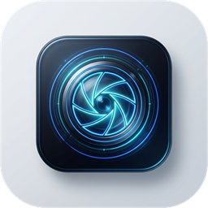
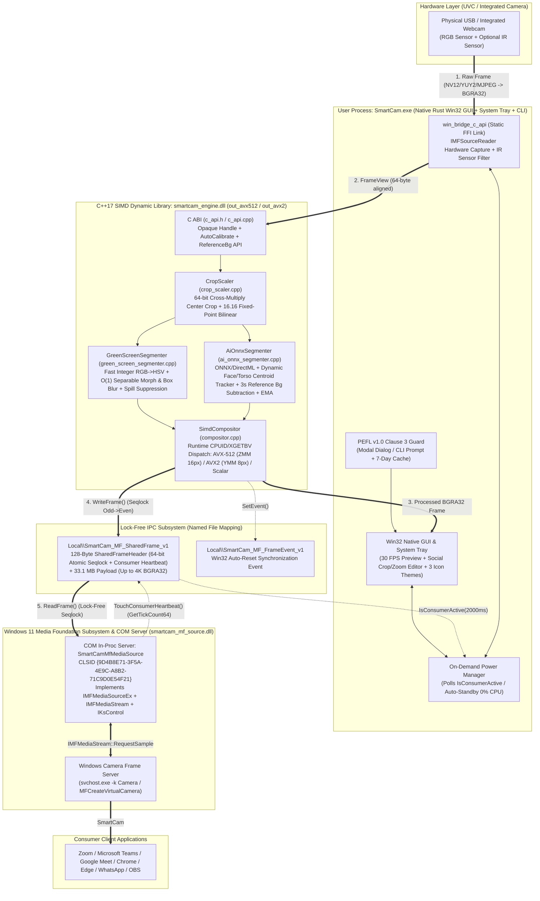

#  SmartCam — Native Real-Time Video Processing Suite & Windows 11 Virtual Camera

[](LICENSE)

> 🌐 **Language / Lingua:** **[🇮🇹 Leggi in Italiano (`README.md`)](README.md)** | **🇬🇧 Read in English (`README_EN.md`)**  
> 📜 **Legal Documents & Plugin SDK:** [`LICENSE` (Master EN)](LICENSE) • [`LICENSE.it` (Italian Translation)](LICENSE.it) • [`NOTICE.md`](NOTICE.md) • [`AI_INSTRUCTIONS.md`](AI_INSTRUCTIONS.md) • **[`🧩 Plugin SDK Guide (how-to-make-a-plugin.md)`](how-to-make-a-plugin.md)**

| <br/>**💠 Cyber Lens** *(Default, ID `101`)* | <br/>**🟢 Emerald Cam** *(Broadcast Studio, ID `102`)* | <br/>**🟣 Neon Iris** *(Creator AI, ID `103`)* |
| :---: | :---: | :---: |
| Cyan/Blue vector lens theme | Emerald Green broadcast theme | High-contrast Purple/Magenta theme |

---

## 📑 Table of Contents (3-Tier Progressive Structure)

1. [⚡ TIER 1 — Quick Overview (What is SmartCam in 30 Seconds)](#-1-quick-overview-what-is-smartcam-in-30-seconds)
2. [🍌 TIER 2 — "Foolproof" Beginner Tutorial (Zero PC Experience Required)](#-2-foolproof-beginner-tutorial-zero-pc-experience-required)
3. [🧠 TIER 3 — Extended Manual for Power Users, Architects & Developers (Technical Deep-Dive)](#-3-extended-manual-for-power-users-architects--developers-technical-deep-dive)
   - [3.1 Complete System Architecture & Repository File Tree](#31-complete-system-architecture--repository-file-tree)
   - [3.2 Mathematical Pipeline, GPU Compute (`Vulkan`/`OpenCL`/`CUDA`/`ROCm`), SIMD (`AVX-512`/`AVX2`) & Smart Benchmark](#32-mathematical-pipeline--simd-vectorization-commonengine)
   - [3.3 Modular Plugin System & Smartphone Camera (`how-to-make-a-plugin.md`)](#33-modular-plugin-system--smartphone-camera-how-to-make-a-pluginmd)
   - [3.4 Windows 11 Media Foundation Subsystem & Linux `AppImage` (`v4l2loopback`)](#34-windows-11-media-foundation-subsystem--linux-appimage-v4l2loopback)
   - [3.5 Advanced Settings, CLI Flags & Configuration File (`config/default_config.yaml`)](#35-advanced-settings-cli-flags--configuration-file-configdefault_configyaml)
   - [3.6 Building from Source, Unit Tests & Packaging (`makeInstaller` / `makeAppImage`)](#36-building-from-source-unit-tests--packaging-makeinstaller--makeappimage)
   - [3.7 Multi-OS Developer & AI Agent Guide](#37-multi-os-developer--ai-agent-guide)

---

# ⚡ 1. QUICK OVERVIEW (What is SmartCam in 30 Seconds)

**SmartCam** instantly transforms any standard USB webcam, built-in laptop camera, or **smartphone camera (Wi-Fi / USB)** into a **studio-grade webcam**, exposing it natively across **Zoom, Microsoft Teams, Google Meet, Chrome, Edge, WhatsApp Desktop, Discord, and OBS Studio** under the clean device name **`"SmartCam"`** (on Windows 11 and Linux).

### What does it do in practice?
- **🎨 Redesigned Ergonomic Studio UX (Zero Overlaps):** clean widescreen layout featuring a **Top Navigation Header** (`🧩 Plugin`, `⚡ Prestazioni, GPU & Benchmark`, `⚙️ Calibrazione`, `🧭 Guida`, `📜 PEFL`, `🔽 Tray` + 3-Icon quick switcher), a **Large Central Live Video Preview** with a semi-transparent telemetry pill overlay (`1440x1080 (4:3) • 30 FPS • Backend: AVX-512 / Vulkan • AI: ON`), and **2 Airy Quick-Control Rows** below the video!
- **💧 Dynamically blurs your background or replaces it with AI** (tracking your face and torso movements in real time without any green cloth), or turns your room into a **📸 Virtual Green Screen ("Cattura Sfondo Reale 3s")**, or removes a physical **🟩 Green Screen (Chroma Key)** with automatic 1-click room lighting calibration.
- **🧩 User-Toggleable Plugin System (`🧩 Gestione Plugin` Modal):** enable or disable built-in and external plugins (`.dll`/`.so` in `plugins/`) with a single click:
  1. **📱 Smartphone Camera (Wi-Fi / USB):** use your Android/iPhone high-definition camera as SmartCam's primary video source (via HTTP/MJPEG IP Webcam, RTSP, or USB tethering)!
  2. **🌐 WebRTC / RTSP Network Stream:** receive low-latency network video feeds.
  3. **🎨 Studio Color & Denoise Enhancer:** automatic skin-tone warmth, contrast, and low-light denoise enhancement.
  4. **📜 Teleprompter Overlay:** subtle on-screen script overlay for presentations and lectures.
  *(Learn how to build your own custom plugin in C/C++ or Rust in **[`how-to-make-a-plugin.md`](how-to-make-a-plugin.md)**!).*
- **⚡ Performance Center: Full Control over CPU vs GPU (`Vulkan`, `OpenCL`, `CUDA`, `ROCm`), AVX Tier (`Auto`, `AVX-512`, `AVX2`, `Scalar`) & AI Toggle (`AI Active` vs `AI Disabled`) + Automatic Hardware Benchmark:**
  - Freely choose between **CPU** and **GPU** (`Vulkan`, `OpenCL`, `NVIDIA CUDA`, `AMD ROCm`, `Auto`), select which **AVX** vector instruction set to use (`Auto`, `AVX-512`, `AVX2`, `Scalar / No-AVX`), and toggle **AI Active** (maximum segmentation quality) vs **AI Disabled** (ultra-lightweight mode).
  - **Smart Hardware Benchmark ("Once Per Hardware Fingerprint"):** on first launch on a new PC, SmartCam runs a fast micro-benchmark (~0.4s), measures scores (`Pt`), max FPS, and estimated CPU load across configurations, highlights the **`⭐ CONSIGLIATO PER IL TUO HARDWARE`** (*Recommended for Your Hardware*) profile, and caches the hardware fingerprint in `config/hardware_benchmark.yaml` so **it never re-runs automatically on subsequent startups on the same hardware** (while always allowing manual re-runs via **`🚀 Esegui Test Prestazioni Ora`** or the System Tray menu!).
- **🖼️ Unified Background Gallery, Custom File Loader & Social-Profile Style Crop Modal:** click **`🖼️ Scegli / Ritaglia Sfondo...`** to pick from **4 visual HD Studio Presets**, load any photo from your PC, and pan/zoom (`100%–400%`) with your mouse!
- **📐 4 Aligned Interactive Dropdown Menus:** choose **Format** (`16:9`, `4:3`, `1:1`, `9:16`), **Definition** (`1080p Full HD` .. `240p`), **Fluidity** (`60` .. `10 FPS`), and **Segmentation Engine** (`Auto`, `AI Silhouette`, `Background Difference`) + **`−` `Tolerance` `+`**.
- **🕵️ Protects you from the "Infrared Camera Trap"** and offers **🎨 3 Selectable Vector Icon Themes (`Cyber Lens`, `Emerald Cam`, `Neon Iris`)**.

### Why is it different from ordinary webcam software?
- **🚀 100% Native (Rust + C++17 SIMD & Multi-GPU, Zero Python, Zero Console Window):** available for both **Windows 11 (`SmartCam_Setup_v1.0.0_x64.exe`)** and **Linux (`SmartCam-x86_64.AppImage`)**.
- **🔋 0% CPU when you are not in a call (On-Demand "Set & Forget"):** when you close the SmartCam window and no video call is active, SmartCam physically powers down your webcam (even the hardware camera LED turns off!). As soon as you open Zoom, Teams, or Meet, your camera wakes up automatically in less than half a second.

### 📜 License Summary — PEFL v1.0 (Personal and Educational Free License)
All source code, executables, and installers of **SmartCam** are released under the **[Personal and Educational Free License (PEFL) v1.0](https://github.com/RubensRainelli/pefl-license-spec)** (see [`LICENSE`](LICENSE), [`LICENSE.it`](LICENSE.it), and [`NOTICE.md`](NOTICE.md)):
- 🟢 **100% FREE for Personal, Domestic, Educational, Academic, and Non-Profit (Third-Sector / Charity) use.**
- 🔴 **STRICTLY PROHIBITED for Corporate, Commercial, Business, Professional, or Government use** without prior written authorization from the Author (**Rubens Rainelli**) and payment of the applicable license fee.
- 🔴 **Places of worship and religious organizations** are explicitly excluded from Personal Use and classified as Corporate Use.
- **Author Contact for Commercial / Enterprise Licensing:**
  - **Author:** Rubens Rainelli
  - **Email:** [rubens@rainelli.it](mailto:rubens@rainelli.it)
  - **GitHub:** [https://github.com/RubensRainelli/](https://github.com/RubensRainelli/)
  - **Phone:** (+39) 342 811 5882

---

# 🍌 2. "FOOLPROOF" BEGINNER TUTORIAL (Zero PC Experience Required)

Not a computer expert? Don't worry! You don't need to type any commands or touch complicated settings. Just follow these **3 easy steps** and you'll be ready in **one minute**.

### 🟢 Step 1: Install in 2 clicks
1. Open the **`dist/`** folder (or wherever you downloaded the program) and **double-click** with your left mouse button on **`SmartCam_Setup_v1.0.0_x64.exe`** (on Linux, simply run **`SmartCam-x86_64.AppImage`**).
2. A window will pop up: check the little box that says *"Accetto i termini della licenza PEFL v1.0..."* (*I accept the PEFL v1.0 license terms*), pick your favorite icon theme, and click the big blue button **"🚀 Installa SmartCam Ora"** (*Install SmartCam Now*).
3. *(Note)* If Windows shows a prompt asking *"Do you want to allow this app to make changes to your device?"*, simply click **"Yes" / "Sì"** (this registers the **`SmartCam`** virtual camera in Windows).

---

### 🪞 Step 2: Look in the mirror, pick your background, Plugins, or Benchmark!
As soon as installation finishes, **SmartCam** opens automatically and **you immediately see your live face** in the large central preview canvas, with live telemetry shown in a sleek semi-transparent pill at the corner of the video and two clean rows of controls underneath!

- **Want to blur your room or place an executive studio behind you?**  
  - Below the video (Row 1), click **💧 Sfoca Sfondo** (*Blur Background*) or **🤖 Sfondo Virtuale** (*Virtual Background*).
  - Click **`🖼️ Scegli / Ritaglia Sfondo...`** to open the Gallery with **4 visual Studio HD thumbnails**, load a custom photo from your PC, and drag/zoom (`100%–400%`) with your mouse!
  - Click **`📸 Cattura Sfondo Reale (3s)`**, step out of the frame for 3 seconds, and sit back down to activate the **Anti-LED Virtual Green Screen**!
- **Want to use your Smartphone as an HD Webcam or enable Filters?**  
  - Click **`🧩 Plugin (Telefono & Filtri)`** in the top bar: toggle **`[ ✅ ATTIVO ]`** on **`📱 Fotocamera Smartphone (Wi-Fi / USB)`**, set your phone's IP camera URL (e.g., `http://192.168.1.100:8080/video`) or USB mode, or enable **`🎨 Studio Color & Denoise Enhancer`**!
- **Want to see the fastest mode for your PC (CPU vs GPU Vulkan/OpenCL/CUDA/ROCm & AVX)?**  
  - Click **`⚡ Prestazioni, GPU & Benchmark`** in the top bar to view your PC's measured benchmark scores and the **`⭐ CONSIGLIATO PER IL TUO HARDWARE`** badge. Click **`✅ Applica Configurazione Consigliata`** or manually select between **CPU / Vulkan / OpenCL / CUDA / ROCm**, **AVX-512 / AVX2 / Scalar**, and **AI Active / AI Disabled**!
- **Want to change Aspect Ratio, Resolution (`1080p..240p`), or Frame Rate (`60..10 FPS`)?**  
  - Use the **4 aligned dropdown menus on Row 2 below the video** (`📺 Formato`, `🎞️ Definizione`, `⏱️ Fluidità`, `🧠 Scontorno`).

---

### 📞 Step 3: Feel free to close with the "X" and open Zoom / Teams / Meet
1. Once you like how you look, **you can safely close the SmartCam window by clicking the `X` in the top-right corner**.
2. **The program does NOT quit:** it goes to sleep quietly near the Windows clock (bottom-right corner of your screen) and turns off your webcam's light so it uses zero battery or CPU.
3. Now open your favorite video calling app (**Zoom, Microsoft Teams, Google Meet in your browser, or WhatsApp**), go to the video settings where you choose your camera, and select:
   > 🎥 **`SmartCam`**
4. **Magic!** As soon as you join a call, your webcam wakes up automatically with all your chosen effects—and when you hang up, it goes right back to sleep on its own!

---

### 🆘 Common Troubleshooting ("Help, it's not working!")

- ❓ **"Everything looks black-and-white, has weird colors, or is flashing!"**  
  👉 Many laptops actually have two cameras built in: a normal color webcam and an "infrared" camera used by Windows to unlock your PC in the dark. If you selected the infrared one, SmartCam shows a **yellow warning banner** above your video: just click the **◀ / ▶** arrows next to **Fotocamera in uso** at the top to switch to your color camera!
- ❓ **"I only see a black screen / Windows is blocking my camera!"**  
  👉 Sometimes Windows 11 blocks camera access for privacy. Click the **"🔓 Sblocca Permessi Cam"** (*Unlock Camera Permissions*) button inside SmartCam: it opens the exact Windows 11 settings page where you just flip the switch to **"On"**. Also make sure another app isn't already holding exclusive access to your webcam.
- ❓ **"I want to see the difference between my normal webcam and SmartCam side by side"**  
  👉 Click the **"🌐 Test 2 Webcam Web"** button inside SmartCam: it opens a local web page in your browser showing your normal webcam on the left and **`SmartCam`** on the right, complete with an interactive before/after wipe slider!

---

# 🧠 3. EXTENDED MANUAL FOR POWER USERS, ARCHITECTS & DEVELOPERS (Technical Deep-Dive)

This section provides an exhaustive technical reference covering SmartCam's internal architecture, fixed-point and SIMD mathematical pipelines, dynamic face/torso tracking with empty-room reference background subtraction, social-profile crop/zoom image processing, lock-free IPC protocol with the Windows Camera Frame Server, CLI flags, and multi-variant build system.

---

## 3.1 Complete System Architecture & Repository File Tree

SmartCam employs a **100% native, strictly modular architecture** that decouples the platform-agnostic C++17 SIMD frame processing engine (`common/engine/`, containing zero OS headers) from OS-specific subsystems (`platforms/windows/`) and the native **Rust** desktop GUI/Tray/CLI controller (`app/`, compiled with `#![windows_subsystem = "windows"]` so launching the GUI never spawns a console window).

### End-to-End Architectural Diagram



### Complete Repository File Tree

```text
SmartCam/
├── LICENSE                         # Official PEFL v1.0 License Text (Master English)
├── LICENSE.it                      # Official Italian Translation of PEFL v1.0
├── NOTICE.md                       # Official PEFL v1.0 Summary & Usage Conditions
├── AI_INSTRUCTIONS.md              # Mandatory Directives for AI Agents (PEFL Clause 3)
├── README.md                       # Primary 3-Tier Documentation (Italian)
├── README_EN.md                    # Complete 3-Tier Documentation (English)
├── SmartCam.exe                    # Native Desktop, CLI & System Tray Executable (Rust Win32, Zero Console)
├── makeInstaller.bat / .ps1        # One-Click Builder generating Windows 11 Installer & Portable ZIP in dist/
├── assets/                         # Multi-resolution vector icons and HD studio backgrounds
│   ├── icons/
│   │   ├── smartcam_logo.png       # High-resolution master logo
│   │   ├── smartcam_cyber_lens.ico # Icon Theme 1: Cyber Lens (Resource ID 101)
│   │   ├── smartcam_emerald_cam.ico# Icon Theme 2: Emerald Cam (Resource ID 102)
│   │   └── smartcam_neon_iris.ico  # Icon Theme 3: Neon Iris (Resource ID 103)
│   └── backgrounds/                # 4 Built-in 1920x1080 Studio Presets
│       ├── preset_1_studio_blue.jpg
│       ├── preset_2_warm_office.jpg
│       ├── preset_3_minimal_loft.jpg
│       └── preset_4_dark_executive.jpg
├── config/                         # Configuration files and schema validation
│   ├── default_config.yaml         # Default runtime configuration (input, framing, HSV, AI, crop, icon)
│   └── config.schema.json          # Strict JSON Schema Draft 2020-12 validator
├── common/                         # SHARED CORE ENGINE (100% Platform-Agnostic, ZERO OS headers)
│   ├── include/                    # Abstract C++17 interfaces and memory structures
│   │   ├── frame_buffer.h          # FrameView & AlignedFrameBuffer (64-byte aligned for AVX-512)
│   │   ├── icamera_source.h        # Pure ICameraSource contract for hardware/remote capture
│   │   ├── ivirtual_camera.h       # Pure IVirtualCamera contract for OS virtual camera sink
│   │   └── isegmenter.h            # ISegmenter contract and alpha mask configurations
│   ├── engine/                     # C++17 algorithmic implementation + C ABI
│   │   ├── CMakeLists.txt          # Multi-target CMake configuration (static, shared DLL, unit tests)
│   │   ├── c_api.h / c_api.cpp     # Exported C ABI (smartcam_engine_create, process_frame, set_reference_background...)
│   │   ├── crop_scaler/            # Distortion-free cropping and 16.16 fixed-point bilinear resampler
│   │   │   └── crop_scaler.h/.cpp
│   │   ├── compositor/             # Vectorized alpha blending (AVX-512, AVX2, Scalar) + Blur/Solid/Image
│   │   │   └── compositor.h/.cpp
│   │   └── segmentation/           # Chromatic and neural segmentation engines
│   │       ├── green_screen_segmenter.h/.cpp  # Integer HSV keyer, O(1) morphology, spill & AutoCalibrate
│   │       └── ai_onnx_segmenter.h/.cpp       # ONNX Runtime + Dynamic Subject Tracker + Reference Bg
│   ├── plugins/                    # Remote video source extensions
│   │   └── webrtc_rtsp_stub.cpp    # Architectural stub for WebRTC / RTSP network streams
│   └── tests/                      # Automated C++17 unit test suite
│       └── test_engine_cpp.cpp     # Bit-exact verification of Crop, HSV, AutoCalibrate, AI Tracking & SIMD
├── platforms/                      # OS-SPECIFIC SUBSYSTEMS
│   ├── windows/                    # *** PRIMARY TARGET: WINDOWS 11 (x86_64) ***
│   │   ├── CMakeLists.txt          # CMake build for smartcam_mf_source.dll and Windows bridge
│   │   ├── win_bridge_c_api.h/.cpp # C ABI bridge statically linked into Rust (Capture + Sink + IR Detect)
│   │   ├── ipc/                    # Lock-free shared-memory frame transport
│   │   │   └── shared_frame_ipc.h  # SharedFrameHeader (128 bytes), 64-bit Atomic Seqlock & Heartbeat
│   │   ├── capture/                # Low-latency webcam capture via Media Foundation
│   │   │   └── mf_camera_capture.h/.cpp # IMFSourceReader, BGRA32 decoding & IR sensor detection
│   │   ├── drivers/                # Windows 11 user-mode Virtual Camera driver
│   │   │   ├── mf_virtual_camera.h/.cpp     # MFCreateVirtualCamera wrapper and producer sink
│   │   │   ├── mf_media_source_com.h/.cpp   # IMFMediaSourceEx / IMFMediaStream COM Server ("SmartCam")
│   │   │   └── smartcam_mf_source.def       # COM exports (DllGetClassObject, DllRegisterServer...)
│   │   ├── scripts/                # PowerShell and Batch automation
│   │   │   ├── make_installer.ps1           # Redistributable packager and C# GUI Setup compiler
│   │   │   ├── register_virtual_camera.ps1  # COM registration + Camera Frame Server verification
│   │   │   ├── start_smartcam.ps1 / .bat    # Launch scripts with PEFL v1.0 guard
│   │   │   └── start_web_preview.ps1        # Local HTTP server launcher for 2-webcam testbench
│   │   └── build/                  # Dual-variant compilation directory
│   │       ├── build_windows.ps1   # Build script for AVX2 and AVX-512 variants
│   │       ├── out_avx2/           # Binaries compiled with /arch:AVX2 (-mavx2 -mfma), 0 ZMM instructions
│   │       └── out_avx512/         # Binaries compiled with /arch:AVX512 (-mavx512f -mavx512bw -mavx512dq -mavx512vl)
│   ├── linux/                      # [STUB/FUTURE] v4l2loopback (/dev/videoX) readiness
│   └── macos/                      # [STUB/FUTURE] CoreMediaIO Camera Extension readiness
├── app/                            # NATIVE RUST DESKTOP APPLICATION + WEB TESTBENCH
│   ├── Cargo.toml                  # Cargo manifest (LicenseRef-PEFL-1.0)
│   ├── build.rs                    # Build script compiling Win32/MF bridge and embedding RC icons
│   ├── smartcam.rc                 # Win32 resource script with 3 embedded icons (IDs 101, 102, 103)
│   ├── src/
│   │   ├── main.rs                 # Entry-point (#![windows_subsystem = "windows"]), CLI parser & GUI launcher
│   │   ├── gui.rs                  # Native Win32 GDI interface, Social Crop/Zoom Modal, 3s Capture, Icon Switcher
│   │   ├── engine_bridge.rs        # Dynamic FFI loader for smartcam_engine.dll + Social Crop/Zoom engine
│   │   ├── win32_ffi.rs            # Win32 FFI, GDI+ (gdiplus.dll) image decoder & File Dialog (comdlg32.dll)
│   │   ├── diagnostics.rs          # Hardware diagnostics, IR webcam filter, and COM status
│   │   ├── config.rs               # Zero-dependency YAML parser/serializer for default_config.yaml
│   │   └── pefl_guard.rs           # PEFL v1.0 Clause 3 compliance guard with 7-day local cache
│   └── web_preview/                # Side-by-Side Web Testbench (2-Webcam Comparison + Wipe Slider)
│       └── index.html
└── dist/                           # Redistributable artifacts generated by .\makeInstaller
    ├── SmartCam_Setup_v1.0.0_x64.exe     # Single-file graphical installer with built-in uninstaller
    ├── SmartCam_Portable_v1.0.0_x64.zip  # Ready-to-run portable archive
    └── SHA256SUMS.txt                    # Cryptographic SHA-256 checksum manifest
```

---

## 3.2 Mathematical Pipeline & SIMD Vectorization (`common/engine/`)

All internal video buffers use [`AlignedFrameBuffer`](file:///c:/Users/Rubens/Dev/SmartCam/common/include/frame_buffer.h), allocated with guaranteed **64-byte memory alignment** (`kSimdAlignment = 64`) and row strides padded to multiples of 64 bytes to maximize L1/L2 cache line utilization and 512-bit vector loads.

### 1. `CropScaler` & Social Background Crop/Zoom ([`common/engine/crop_scaler/`](file:///c:/Users/Rubens/Dev/SmartCam/common/engine/crop_scaler/crop_scaler.cpp), [`app/src/engine_bridge.rs`](file:///c:/Users/Rubens/Dev/SmartCam/app/src/engine_bridge.rs))
Eliminates geometric face distortion caused when wide `16:9` webcam feeds are forced into `4:3` or `1:1` containers:
- **Distortion-Free Center Crop Computation (`ComputeCenterCropRect`):** compares the source aspect ratio $W_{\text{src}} / H_{\text{src}}$ against the target $A_w / A_h$ using **64-bit integer cross-multiplication**, completely avoiding floating-point precision drift:
  $$\text{lhs} = W_{\text{src}} \cdot A_h, \qquad \text{rhs} = H_{\text{src}} \cdot A_w$$
  - When $\text{lhs} > \text{rhs}$ (source wider than target, e.g., `1920x1080` `16:9` $\to$ `4:3` target), it crops horizontally and masks the width to an even integer (`target_w &= ~1u`) for YUV/NV12 encoder compatibility:
    $$W_{\text{crop}} = \left\lfloor \frac{H_{\text{src}} \cdot A_w}{A_h} \right\rfloor \ \& \ \sim 1, \qquad H_{\text{crop}} = H_{\text{src}}, \qquad X_0 = \frac{W_{\text{src}} - W_{\text{crop}}}{2}, \qquad Y_0 = 0$$
  - **Zero-Cost Nominal `1920x1080` (16:9) $\to$ `1440x1080` (4:3) Fast Path:** because the computed crop ROI ($1440 \times 1080$ at horizontal offset $X_0 = 240$) matches the output dimensions ($1440 \times 1080$) 1:1, `ResizeBilinearROI` triggers a **direct scanline `std::memcpy` fast-path** (`row_bytes = 1440 * 4 = 5760` bytes) with zero resampling overhead and zero optical blur.
- **Social-Profile Style Crop & Zoom for Background Images (`compute_social_crop_rect`):** given a loaded background image $(W_{\text{bg}}, H_{\text{bg}})$, active output dimensions $(W_{\text{out}}, H_{\text{out}})$, zoom factor $Z \in [1.0, 4.0]$, and normalized pan coordinates $(P_x, P_y) \in [0, 1]^2$, computes the largest aspect-matched crop window divided by $Z$:
  $$W_{\text{win}} = \frac{W_{\text{base}}}{Z}, \qquad H_{\text{win}} = \frac{H_{\text{base}}}{Z}, \qquad X_0 = \lfloor (W_{\text{bg}} - W_{\text{win}}) \cdot P_x \rfloor, \qquad Y_0 = \lfloor (H_{\text{bg}} - H_{\text{win}}) \cdot P_y \rfloor$$
- **`16.16` Fixed-Point Bilinear Resampling (`ResizeBilinearROI`):** when scaling is required (or when upsampling the `256x144` AI probability mask to `1440x1080`), source coordinates are stepped via 32-bit fixed-point ratios:
  $$\text{scale}_x = \frac{W_{\text{roi}} \ll 16}{W_{\text{dst}}}, \qquad \text{scale}_y = \frac{H_{\text{roi}} \ll 16}{H_{\text{dst}}}$$
  8-bit fractional weights $w_x, w_y \in [0, 255]$ and their complements $\bar{w}_x = 256 - w_x, \bar{w}_y = 256 - w_y$ yield four bilinear weights $w_{00}, w_{10}, w_{01}, w_{11}$ summing to $256 \times 256 = 65536 = 2^{16}$, allowing exact normalization via a single right-shift `>> 16`:
  $$I_{\text{out}}(x, y) = \bigl( P_{00} \cdot \bar{w}_x \bar{w}_y + P_{10} \cdot w_x \bar{w}_y + P_{01} \cdot \bar{w}_x w_y + P_{11} \cdot w_x w_y \bigr) \gg 16$$

### 2. `GreenScreenSegmenter` & Auto-Calibration ([`common/engine/segmentation/green_screen_segmenter.cpp`](file:///c:/Users/Rubens/Dev/SmartCam/common/engine/segmentation/green_screen_segmenter.cpp))
A deterministic, sub-millisecond chroma-key pipeline resilient to uneven room lighting:
- **Fast Integer `RgbToHsvFast` Conversion:** transforms each pixel $(R, G, B) \in [0, 255]^3$ into cylindrical $(H, S, V)$ coordinates with $H \in [0, 180]$ (OpenCV-compatible half-degree scale fitting inside a `uint8_t`) and $S, V \in [0, 255]$ using pure integer math:
  $$V = \max(R, G, B), \qquad \Delta = V - \min(R, G, B), \qquad S = \begin{cases} \lfloor 255 \cdot \Delta / V \rfloor & \text{if } V > 0 \\ 0 & \text{if } V = 0 \end{cases}$$
  A pixel is classified as background (`mask = 0`) if $(H \in [H_{\min}, H_{\max}]) \land (S \in [S_{\min}, S_{\max}]) \land (V \in [V_{\min}, V_{\max}])$, and foreground (`mask = 255`) otherwise.
- **$O(1)$ Separable Morphological Opening (`MorphologicalOpen`):** strips isolated chroma noise speckles without the $O(K^2)$ cost of 2D kernels. Performs a **1D horizontal + 1D vertical Erosion** ($\min$ filter over $[-r, +r]$) followed by a **1D horizontal + 1D vertical Dilation** ($\max$ filter over $[-r, +r]$).
- **$O(1)$ Sliding-Window Soft-Edge Blur (`SeparableSoftBlur`):** runs **two consecutive passes** of a separable 1D box filter (horizontal + vertical) using a sliding accumulator (`sum += src[right] - src[left]`). By the Central Limit Theorem, two box-filter passes closely approximate a Gaussian feathering kernel at strictly $O(1)$ cost per pixel regardless of `blur_radius`.
- **Green Spill Suppression (`SuppressGreenSpill`):** removes green light reflected from the backdrop onto hair, shoulders, and skin edges. For every pixel with $\alpha > 0$, it computes the Red/Blue average $\overline{RB} = (R + B) \gg 1$; whenever $G > \overline{RB}$, excess green is attenuated in `8.8` fixed-point (`strength_fp` $\in [0, 256]$):
  $$G_{\text{new}} = G - \bigl( (G - \overline{RB}) \cdot \text{strength}_{\text{fp}} \gg 8 \bigr)$$
- **Statistical `AutoCalibrate` Algorithm (1-Click & Eyedropper):**
  - When triggered by clicking on the live video preview (`sample_x >= 0, sample_y >= 0`), it samples a square patch of radius $\max(4, \min(W, H)/32)$ around the clicked coordinates.
  - When triggered via the 1-Click Auto-Calibrate button (`sample_x = -1, sample_y = -1`), it samples two rectangular patches in the upper-left and upper-right background corners.
  - Across the collected samples, it computes the **median** ($\tilde{\mu}_H, \tilde{\mu}_S, \tilde{\mu}_V$), **mean** ($\mu$), **standard deviation** ($\sigma_H, \sigma_S, \sigma_V$), and **5th / 95th percentiles** ($P_{05}, P_{95}$), deriving outlier-resistant HSV bounds:
    $$\text{tol}_H = \max(12, \, 2.5\sigma_H + 6), \quad \text{tol}_S = \max(35, \, 3.0\sigma_S + 15), \quad \text{tol}_V = \max(45, \, 3.0\sigma_V + 20)$$
    $$H_{\min} = \text{clamp}\bigl(\min(P_{05,H} - 8, \, \tilde{\mu}_H - \text{tol}_H), \, 0, \, 180\bigr), \qquad H_{\max} = \text{clamp}\bigl(\max(P_{95,H} + 8, \, \tilde{\mu}_H + \text{tol}_H), \, H_{\min}, \, 180\bigr)$$
    $$S_{\min} = \text{clamp}\bigl(\min(P_{05,S} - 15, \, \tilde{\mu}_S - \text{tol}_S), \, 10, \, 240\bigr), \qquad V_{\min} = \text{clamp}\bigl(\min(P_{05,V} - 20, \, \tilde{\mu}_V - \text{tol}_V), \, 15, \, 240\bigr)$$

### 3. `AiOnnxSegmenter` — Dynamic Face/Torso Tracking & Empty-Room Reference Subtraction ([`common/engine/segmentation/ai_onnx_segmenter.cpp`](file:///c:/Users/Rubens/Dev/SmartCam/common/engine/segmentation/ai_onnx_segmenter.cpp))
- **NHWC Tensor Pre-Processing (`PrepareInputTensorNHWC`):** downsamples the input frame to the neural network resolution (`256x144` by default) using `16.16` fixed-point coordinate stepping and normalizes RGB channels to $[0.0, 1.0]$ floats.
- **ONNX Runtime C++ / DirectML Inference & Real-Time Dynamic Portrait Engine (`RunPortraitHeuristicFallback`):**
  1. **Empty-Room Reference Background Subtraction (`SetReferenceBackground` / `"📸 Cattura Sfondo Vuoto (3s)"`):** when the user captures a 3-second empty-room reference frame, the segmenter computes per-pixel luma + chroma distance $\Delta_{\text{ref}}(x, y)$ at `256x144`, cleanly isolating the entire person regardless of clothing color.
  2. **Dynamic Skin-Tone YCbCr + Inter-Frame Motion Centroid Tracker:** on every frame, detects human skin chrominance ($C_r \in [133, 178], C_b \in [77, 128]$) and inter-frame temporal motion ($\Delta_{\text{motion}} = |Y_t - Y_{t-1}|$), updating the tracked head/torso centroid $(c_x, c_y)$ with smooth EMA inertia ($\alpha_{\text{track}} = 0.30$).
  3. **Anchored Dual-Ellipsoid Head+Torso Silhouette & Edge-Guided Refinement:** constructs an anatomical head + shoulders/torso mask that **dynamically follows the user horizontally and vertically across the frame**, refining edges against adaptive perimeter background models.
- **EMA Anti-Flickering Temporal Filter (`PostProcessProbabilityMap`):** stabilizes the probability map $P_t(x, y) \in [0, 1]$ across consecutive frames using an **Exponential Moving Average (EMA)** governed by `temporal_smoothing` ($\beta \in [0.0, 0.90]$):
  $$\hat{P}_t(x, y) = (1 - \beta) \cdot P_t(x, y) + \beta \cdot \hat{P}_{t-1}(x, y)$$
- **Anti-Aliased Smoothstep & Bilinear Upsampling:** applies a cubic Hermite *smoothstep* ramp across a transition band $\delta = 0.15$ around `confidence_threshold` ($\tau$) before upsampling to full output resolution via `CropScaler::ResizeBilinearROI`:
  $$t = \text{clamp}\left(\frac{\hat{P}_t(x, y) - (\tau - \delta)}{2\delta}, \, 0, \, 1\right), \qquad \alpha(x, y) = \lfloor 255 \cdot t^2 (3 - 2t) + 0.5 \rfloor$$

### 4. `SimdCompositor` ([`common/engine/compositor/compositor.cpp`](file:///c:/Users/Rubens/Dev/SmartCam/common/engine/compositor/compositor.cpp))
Blends the foreground subject ($F$), the selected background ($B$: custom/preset cropped image, blurred live frame, or solid RGB color), and the alpha mask ($M$).

- **16-Bit Fixed-Point Alpha-Blending Formula:** to avoid slow integer divisions by `255`, opacity $a \in [0, 255]$ is mapped into $[0, 256]$ using the boundary-exact shift identity ($0 \to 0$, $255 \to 256$):
  $$\alpha_{\text{scaled}} = a + (a \gg 7), \qquad \bar{\alpha}_{\text{scaled}} = 256 - \alpha_{\text{scaled}}$$
  Each color channel is then blended in 16-bit lanes with zero overflow:
  $$C_{\text{out}} = \bigl( C_{\text{fg}} \cdot \alpha_{\text{scaled}} + C_{\text{bg}} \cdot \bar{\alpha}_{\text{scaled}} \bigr) \gg 8$$
- **Dynamic Hardware Dispatch (`CPUID` + `XGETBV`):** at startup, `SimdCompositor::DetectBestSimdTier()` queries the CPU directly:
  1. `CPUID` Leaf `1` (`ECX` bit 27 `OSXSAVE` and bit 28 `AVX`).
  2. `XGETBV(0)` instruction to inspect extended control register `XCR0`: verifies that the Windows OS kernel preserves vector registers across context switches (`(xcr0 & 0x6) == 0x6` for 256-bit `XMM/YMM` state; `(xcr0 & 0xE6) == 0xE6` for 512-bit `ZMM` and `k0..k7` opmask state).
  3. `CPUID` Leaf `7`, Subleaf `0` (`EBX` bit 5 `AVX2`, bit 16 `AVX512F`, bit 30 `AVX512BW`).
- **Technical Comparison Between `out_avx512` and `out_avx2` Builds:**

| Feature | `out_avx512` Variant (`smartcam_engine_avx512.dll`) | `out_avx2` Variant (`smartcam_engine_avx2.dll`) |
| :--- | :--- | :--- |
| **Vector Registers** | **512-bit** `ZMM0..ZMM31` | **256-bit** `YMM0..YMM15` |
| **Throughput per Iteration** | **16 pixels** (**64 bytes** BGRA32) per loop step | **8 pixels** (**32 bytes** BGRA32) per loop step |
| **Core Intrinsics** | `_mm512_loadu_si512`, `_mm512_cvtepu8_epi32`, `_mm512_mullo_epi32`, `_mm512_unpacklo/hi_epi8`, `_mm512_mullo_epi16`, `_mm512_packus_epi16` | `_mm256_loadu_si256`, `_mm256_cvtepu8_epi32`, `_mm256_mullo_epi32`, `_mm256_unpacklo/hi_epi8`, `_mm256_mullo_epi16`, `_mm256_packus_epi16` |
| **Compiler Flags** | MSVC: `/O2 /arch:AVX512`<br/>GCC/Clang: `-O3 -mavx2 -mfma -mavx512f -mavx512bw -mavx512dq -mavx512vl` | MSVC: `/O2 /arch:AVX2`<br/>GCC/Clang: `-O3 -mavx2 -mfma` |
| **ISA Isolation Guarantee** | Enables `BlendRowAVX512` with automatic runtime fallback to `BlendRowAVX2` / `BlendRowScalar` | **Guaranteed `0` `ZMM` instructions** in compiled binary (100% safe on any CPU without AVX-512) |

---

## 3.3 Windows 11 Media Foundation Subsystem & On-Demand IPC (`platforms/windows/`)

On Windows 11, virtual cameras interact with the system **Windows Camera Frame Server (`svchost.exe -k Camera`)** via the **Media Foundation (`IMFMediaSourceEx`)** architecture. Because the Camera Frame Server loads the virtual camera COM DLL into its own service process address space, SmartCam bridges the user process and the COM server via zero-latency shared memory.

### 1. 128-Byte Binary Layout of `SharedFrameHeader` ([`platforms/windows/ipc/shared_frame_ipc.h`](file:///c:/Users/Rubens/Dev/SmartCam/platforms/windows/ipc/shared_frame_ipc.h))
The named file mapping `Local\SmartCam_MF_SharedFrame_v1` (paired with event `Local\SmartCam_MF_FrameEvent_v1`) starts with a 128-byte aligned `SharedFrameHeader` (`#pragma pack(push, 8)`), followed by a **33,177,600-byte** pixel payload (supporting up to **4K UHD `3840x2160` BGRA32**):

| Byte Offset | Field | C++ Type | Size | Technical Description |
| :---: | :--- | :--- | :---: | :--- |
| `0x00` (0) | `magic` | `uint32_t` | 4 B | Constant magic signature `0x534D434D` (`"SMCM"`) |
| `0x04` (4) | `version` | `uint32_t` | 4 B | IPC protocol version (`1`) |
| `0x08` (8) | `sequence_counter` | `volatile LONG64` | 8 B | **64-bit Atomic Seqlock Counter:** *Odd* = writer in progress, *Even* = consistent frame ready |
| `0x10` (16) | `width` | `uint32_t` | 4 B | Active frame width in pixels (e.g., `1440`) |
| `0x14` (20) | `height` | `uint32_t` | 4 B | Active frame height in pixels (e.g., `1080`) |
| `0x18` (24) | `stride` | `uint32_t` | 4 B | Bytes per row (`width * 4` for `BGRA32`) |
| `0x1C` (28) | `fps_num` | `uint32_t` | 4 B | Target framerate numerator (e.g., `30`) |
| `0x20` (32) | `fps_den` | `uint32_t` | 4 B | Target framerate denominator (e.g., `1`) |
| `0x24` (36) | `pixel_format` | `uint32_t` | 4 B | Pixel format code (`4` = `PixelFormat::BGRA32`) |
| `0x28` (40) | `timestamp_100ns` | `uint64_t` | 8 B | Media Foundation Presentation Timestamp in $100\text{ ns}$ units |
| `0x30` (48) | `frame_index` | `uint64_t` | 8 B | Monotonic produced frame counter |
| `0x38` (56) | `last_consumer_heartbeat_ms` | `volatile LONG64` | 8 B | `GetTickCount64()` (ms) timestamp of the last client sample request |
| `0x40` (64) | `consumer_requests` | `volatile LONG64` | 8 B | Monotonic atomic counter of `RequestSample` calls |
| `0x48` (72) | `reserved[48]` | `uint8_t[48]` | 48 B | Explicit padding to the **128-byte** (`0x80`) cache-line boundary |
| `0x80` (128) | `Payload()` | `uint8_t[]` | 33.1 MB | Contiguous `BGRA32` pixel payload read by the COM server |

### 2. Lock-Free Synchronization via 64-Bit Atomic Seqlock
To avoid kernel mutex contention between the real-time producer thread and the Windows Camera Frame Server:
- **Writer (`WriteFrame` in `SmartCam.exe`):**
  1. Atomically increments `sequence_counter` via `InterlockedIncrement64` to an **odd** number (signaling write in progress) and issues `MemoryBarrier()`.
  2. Updates frame metadata (`width`, `height`, `stride`, `timestamp_100ns`, `frame_index`) and copies pixel data into `Payload()`.
  3. Issues `MemoryBarrier()` and a second `InterlockedIncrement64(&hdr->sequence_counter)`, restoring the counter to an **even** value (consistent frame ready), then signals `SetEvent(frame_event_)`.
- **Reader (`ReadFrame` in `smartcam_mf_source.dll`):**
  1. Reads `seq_before` via `InterlockedCompareExchange64`. If `(seq_before & 1LL) != 0` (writer active), it yields briefly via `SwitchToThread()` and retries (up to 3 attempts).
  2. Copies the pixel payload and checks `MemoryBarrier()` + `seq_after`: accepts the frame only if `seq_before == seq_after && seq_after > 0`.

### 3. On-Demand Activation Protocol ("0% CPU Idle")
1. Whenever a client app (Zoom, Teams, Chrome, OBS) starts the stream or requests a sample via `SmartCamMfMediaStream::RequestSample`, the COM server invokes `TouchConsumerHeartbeat()`, atomically storing `GetTickCount64()` into `last_consumer_heartbeat_ms` and incrementing `consumer_requests`.
2. When the `SmartCam.exe` window is closed to the System Tray, the main loop polls `IsConsumerActive(2000)`:
   - If `GetTickCount64() - last_consumer_heartbeat_ms <= 2000` ms, at least one consumer application is actively streaming $\to$ SmartCam keeps the hardware webcam open and processes frames at 30 FPS.
   - Once no heartbeat is received for over 2 seconds (call ended) and the preview window is hidden $\to$ SmartCam releases `IMFSourceReader`, **physically powers down the webcam (LED off)**, and drops CPU usage to **0%**, waking up instantaneously on the next heartbeat.

### 4. Media Foundation COM Server (`smartcam_mf_source.dll`) & Linux `v4l2loopback` (`makeAppImage`)
- **Windows 11 COM Class Identifier (`CLSID`):** `{9D4B8E71-3F5A-4E9C-A8B2-71C9D0E54F21}` — Friendly Name `"SmartCam"`.
- Implements standard Windows 11 [`IMFMediaSourceEx`](file:///c:/Users/Rubens/Dev/SmartCam/platforms/windows/drivers/mf_media_source_com.h), `IMFMediaSource`, `IMFGetService`, `IKsControl`, and [`IMFMediaStream`](file:///c:/Users/Rubens/Dev/SmartCam/platforms/windows/drivers/mf_media_source_com.cpp) interfaces.
- **Linux (`platforms/linux/` & `makeAppImage.sh`):** on Linux, SmartCam captures frames via **Video4Linux2 (`V4L2`, `/dev/video0`)** with memory-mapped buffers (`VIDIOC_QBUF`/`VIDIOC_DQBUF`), runs the same C++17 SIMD/GPU pipeline, and streams output to the **`v4l2loopback`** kernel module (`/dev/video10`, card label `"SmartCam"`), packaged as a portable **`SmartCam-x86_64.AppImage`**.

---

## 3.3 Modular Plugin System & Smartphone Camera (`how-to-make-a-plugin.md`)

SmartCam features a dynamic native plugin architecture (`.dll` on Windows, `.so` on Linux) alongside built-in plugins managed in real time via the **`🧩 Gestione Plugin (Sorgenti & Filtri)`** modal (`app/src/plugins.rs`):
- **`📱 Fotocamera Smartphone (Wi-Fi / USB)` (`phone_camera`):** turns an Android or iOS smartphone into an HD wireless/USB webcam (compatible with HTTP/MJPEG IP Webcam streams such as `http://192.168.1.100:8080/video`, RTSP feeds, or USB ADB forwarding).
- **`🌐 WebRTC / RTSP Network Stream` (`webrtc_rtsp`):** low-latency network stream receiver for IP cameras and studio feeds.
- **`🎨 Studio Color & Denoise Enhancer` (`studio_color`):** post-processing enhancer optimizing skin-tone warmth, local contrast, and low-light denoise.
- **`📜 Teleprompter Overlay` (`teleprompter`):** on-screen script overlay for presentations and lectures.
- 📖 **Want to write your own custom plugin in C, C++, or Rust?** Read the complete SDK guide in **[`how-to-make-a-plugin.md`](how-to-make-a-plugin.md)** covering the `SmartCamPlugin_v1` C ABI (`common/include/iplugin.h`).

---

## 3.4 CPU/GPU Control (`Vulkan`, `OpenCL`, `CUDA`, `ROCm`), AVX Tier, AI Toggle & Smart Hardware Benchmark

From the **`⚡ Centro Prestazioni: CPU/GPU, AVX, AI & Benchmark`** modal (`app/src/benchmark.rs`), users have complete, transparent control over hardware acceleration:
1. **Compute Device Selector (`compute_backend`):** `Auto`, `CPU`, `Vulkan`, `OpenCL`, `NVIDIA CUDA`, `AMD ROCm` with live detection of installed GPU runtimes/drivers and GPU model name.
2. **CPU Vector Instruction Selector (`simd_acceleration`):** `Auto`, `AVX-512 (512-bit ZMM)`, `AVX2 (256-bit YMM)`, `Scalar (No-AVX)`.
3. **AI Toggle (`ai_enabled`):** `🤖 AI Active (Maximum Segmentation Quality)` vs `🍃 AI Disabled (Ultra-Lightweight / Background Diff & Chroma Only)`.
4. **Automatic Hardware Benchmark ("Once Per Hardware Fingerprint"):**
   - Computes a hardware fingerprint (`CPU Brand + Logical Cores + RAM + GPU Model + AVX Flags`).
   - On first launch on new hardware (after PEFL v1.0 acceptance), runs a fast (~0.4s) benchmark, scores each combination (`Pt`, max FPS, estimated CPU load `%`), highlights the optimal profile with **`⭐ CONSIGLIATO PER IL TUO HARDWARE`**, and saves the report to `config/hardware_benchmark.yaml`.
   - On subsequent launches on the same hardware, it **does not re-run automatically**, preserving cached scores while allowing manual re-runs at any time via **`🚀 Esegui Test Prestazioni Ora`**, the System Tray menu, or CLI (`SmartCam.exe --benchmark`).

---

## 3.5 Advanced Settings, CLI Flags & Configuration File (`config/default_config.yaml`)

### 1. Advanced GUI Settings & [`config/default_config.yaml`](file:///c:/Users/Rubens/Dev/SmartCam/config/default_config.yaml) Reference

| YAML Section | Key | Default | GUI Control / Allowed Values | Technical Description |
| :--- | :--- | :---: | :--- | :--- |
| *(root)* | `app_icon_theme` | `"cyber_lens"` | **🎨 Icona App & Tray** Selector (`"cyber_lens"`, `"emerald_cam"`, `"neon_iris"`) | Active icon theme for Win32 window (`WM_SETICON`) and System Tray |
| *(root)* / `compositor` | `compute_backend` | `"auto"` | **⚡ Prestazioni** Modal (`"auto"`, `"cpu"`, `"vulkan"`, `"opencl"`, `"cuda"`, `"rocm"`) | User-selected CPU or GPU compute backend |
| *(root)* / `ai_selfie` | `ai_enabled` | `true` | **⚡ Prestazioni** Modal (`true` = AI Active, `false` = AI Disabled) | Enables or disables neural AI segmentation in favor of lightweight mode |
| *(root)* | `enabled_plugins` | `[]` | **🧩 Plugin** Modal (ID list e.g. `["phone_camera", "studio_color"]`) | List of user-enabled plugins |
| *(root)* | `phone_camera_url` | `"http://192.168.1.100:8080/video"` | **🧩 Plugin** Modal (Smartphone Camera config) | Wi-Fi / USB endpoint URL for smartphone camera streaming |
| `camera_input` | `device_index` | `0` | **Camera** Selector (`◀` / `▶`) | Physical webcam index (auto-selects first non-IR RGB webcam) |
| `camera_input` | `width` / `height` / `fps` | `1920` / `1080` / `30` | **Frame Rate Dropdown (`60..10 FPS`)** / YAML | Capture resolution and target frame rate (`60`, `30`, `25`, `24`, `20`, `15`, `10`) |
| `framing_output` | `aspect_ratio` | `"4:3"` | **Format Dropdown** (`"16:9"`, `"4:3"`, `"1:1"`, `"9:16"`) | Target aspect ratio applied by `CropScaler` via center cropping |
| `framing_output` | `resolution_preset` | `"1080p"` | **Definition Dropdown** (`"1080p"`, `"900p"`, `"720p"`, `"540p"`, `"480p"`, `"360p"`, `"240p"`) | Output definition tier dynamically coupled to the selected aspect ratio |
| `framing_output` | `crop_strategy` | `"center_crop"` | `"center_crop"` \| `"letterbox"` | Full center crop vs. black letterbox/pillarbox bars |
| `framing_output` | `output_width` / `output_height` | `1440` / `1080` | Computed automatically from `(aspect_ratio, resolution_preset)` | Output frame dimensions sent to the `"SmartCam"` Virtual Camera |
| `segmentation` | `mode` | `"ai_selfie"` | Effect Buttons (`"passthrough"`, `"green_screen"`, `"ai_selfie"`) | Active segmentation algorithm |
| `green_screen` | `hue_min` / `hue_max` | `35` / `85` | **Hue Min / Hue Max** Controls `[0..180]` | HSV Hue range for the green backdrop |
| `green_screen` | `sat_min` / `sat_max` | `45` / `255` | **Sat Min / Sat Max** Controls `[0..255]` | HSV Saturation range for the green backdrop |
| `green_screen` | `val_min` / `val_max` | `45` / `255` | **Val Min / Val Max** Controls `[0..255]` | HSV Value (brightness) range for the green backdrop |
| `green_screen` | `morph_kernel_size` | `3` | **Morph** Button (`0`, `3`, `5`) | Kernel size for $O(1)$ separable morphological opening |
| `green_screen` | `blur_radius` | `2` | **Blur** Control `[0..10]` | Pixel radius for the 2-pass soft-edge box filter |
| `green_screen` | `spill_suppression` | `0.35` | **Spill** Control `[0.0..1.0]` | Attenuation strength for green reflections on subject edges |
| `ai_selfie` | `confidence_threshold` | `0.50` | **AI Conf** Control `[0.10..0.90]` | Probability cutoff separating foreground person from background |
| `ai_selfie` | `temporal_smoothing` | `0.25` | **EMA** Control `[0.0..0.85]` | Exponential weight $\beta$ suppressing inter-frame mask flicker |
| `ai_selfie` | `engine_mode` | `0` | **AI Engine Dropdown** (`0=Auto Hybrid`, `1=Silhouette & Face`, `2=Background Difference`) | AI segmentation strategy and use of the captured reference room background |
| `ai_selfie` | `bg_diff_tolerance` | `0.50` | **Lighting/LED & Position Tolerance** (`−` / `+`, `[0.05..1.00]`) | Invariance to monitor LED/lighting shifts and minor posture movements |
| `compositor` | `simd_acceleration` | `"auto"` | **AVX/SIMD** Selector (`"auto"`, `"avx512"`, `"avx2"`, `"scalar"`) | Vector instruction set used by the C++ compositor |
| `compositor` | `background_mode` | `"image"` | `"image"` \| `"blur"` \| `"solid_color"` | Background fill mode |
| `compositor` | `background_image_path` | `"assets/backgrounds/preset_1_studio_blue.jpg"` | **`🖼️ Scegli / Ritaglia Sfondo...`** Modal | Path to background image (`.jpg`, `.png`, `.bmp`, `.webp`) |
| `compositor` | `background_zoom` | `1.00` | **`🖼️ Scegli / Ritaglia Sfondo...`** Modal (`1.00` .. `4.00`) | Background image zoom factor |
| `compositor` | `background_pan_x` / `pan_y` | `0.50` / `0.50` | Mouse drag inside **`🖼️ Scegli / Ritaglia Sfondo...`** Modal | Normalized `[0.0..1.0]` pan offsets for background crop |
| `compositor` | `background_color_rgb` | `[24, 34, 56]` | **🎨 Colore RGB** Button | Solid background RGB color (`[R, G, B]`) |
| `compositor` | `background_blur_radius` | `15` | **Bokeh** Control `[3..45]` | Background blur strength |

---

### 2. [`SmartCam.exe`](file:///c:/Users/Rubens/Dev/SmartCam/app/src/main.rs) Command-Line Interface (CLI) Flags

```powershell
# Launch full desktop GUI with live video preview (Zero Console Window)
.\SmartCam.exe

# Launch minimized directly into the Windows System Tray (On-Demand 0% CPU idle mode)
.\SmartCam.exe --minimized

# Run full Hardware Benchmark (CPU/GPU Vulkan/OpenCL/CUDA/ROCm + AVX-512/AVX2/Scalar + AI)
.\SmartCam.exe --benchmark

# Configure GPU/CPU Backend, AVX, AI, and Plugins from the command line
.\SmartCam.exe --set-backend vulkan --simd avx512 --set-ai on --enable-plugin phone_camera --enable-plugin studio_color

# Print full diagnostic report as JSON
.\SmartCam.exe --status --json

# Run pipeline in Headless mode (no GUI window) for N frames and exit
.\SmartCam.exe --headless --frames 120
```

**Complete Reference Table of `SmartCam.exe` CLI Flags:**

| CLI Flag | Supported Aliases | Argument | Description |
| :--- | :--- | :---: | :--- |
| `--minimized` | — | None | Starts hidden in the Windows System Tray with On-Demand camera activation |
| `--benchmark` | — | None | Runs CPU/GPU/AVX/AI hardware benchmark, writes `config/hardware_benchmark.yaml`, and prints scores |
| `--set-backend <val>` | `--backend <val>` | `auto` \| `cpu` \| `vulkan` \| `opencl` \| `cuda` \| `rocm` | Sets the active CPU or GPU compute backend |
| `--set-ai <val>` | `--ai <val>` | `on` \| `off` \| `true` \| `false` | Enables or disables AI segmentation |
| `--enable-plugin <id>` | — | `phone_camera` \| `webrtc_rtsp` \| `studio_color` \| `teleprompter` | Enables a plugin and updates `default_config.yaml` |
| `--disable-plugin <id>` | — | `<id>` | Disables a plugin and updates `default_config.yaml` |
| `--status` | — | None | Prints SIMD/GPU engine status, detected cameras (with `[IR]` / `[RGB]` tags), and COM registration |
| `--json` | *(with `--status`)* | None | Formats `--status` output as a valid JSON object |
| `--headless` | — | None | Runs capture, SIMD processing, and IPC frame delivery without opening a GUI window |
| `--frames <N>` | — | Integer `N` | Processes exactly `N` frames in headless mode, prints average FPS, and exits |
| `--mode <val>` | `--set-mode <val>` | `passthrough` \| `green_screen` \| `ai_selfie` | Updates and saves the active segmentation mode in `default_config.yaml` |
| `--aspect-ratio <val>` | `--set-aspect <val>` | `16:9` \| `4:3` \| `1:1` \| `9:16` | Updates and saves the framing aspect ratio and recalculates output dimensions |
| `--set-resolution <val>` | `--resolution <val>` | `1080p` \| `900p` \| `720p` \| `540p` \| `480p` \| `360p` \| `240p` | Updates and saves the output definition preset and recalculates `output_width` / `output_height` |
| `--set-fps <val>` | `--fps <val>` | `60` \| `30` \| `25` \| `24` \| `20` \| `15` \| `10` | Updates and saves the output frame rate (`10..60 FPS`) |
| `--set-engine-mode <val>` | `--engine-mode <val>` | `0` \| `1` \| `2` | Sets the AI segmentation engine mode (`0=Auto`, `1=Silhouette & Face`, `2=Background Difference`) |
| `--set-bg-tolerance <val>` | `--bg-tolerance <val>` | Float `0.05..1.00` | Sets lighting/LED and posture tolerance for background segmentation |
| `--set-bg <val>` | — | `solid_color` \| `blur` \| `image` | Updates and saves the compositor background mode |
| `--set-icon <val>` | `--icon <val>` | `cyber_lens` \| `emerald_cam` \| `neon_iris` | Updates and saves the window and System Tray icon theme |
| `--simd <val>` | `--set-simd <val>` | `auto` \| `avx512` \| `avx2` \| `scalar` | Updates and saves the requested SIMD acceleration tier |
| `--build-variant <dir>` | — | `out_avx2` \| `out_avx512` | Selects which C++ binary directory to load via FFI |
| `--config <path>` | — | File path | Uses a custom YAML configuration file path |
| `--register-driver` | — | None | Registers `smartcam_mf_source.dll` (`"SmartCam"`) in the Windows COM registry |
| `--unregister-driver` | — | None | Removes the Virtual Camera COM registration |
| `--open-web-testbench` | — | None | Starts and opens the local Side-by-Side 2-webcam comparison web page |
| `--accept-pefl` | — | None | Records PEFL v1.0 license acceptance for the current session |
| `--help` | `-h` | None | Prints command-line usage help |

---

### 3. Installer [`SmartCam_Setup_v1.0.0_x64.exe`](file:///c:/Users/Rubens/Dev/SmartCam/platforms/windows/scripts/make_installer.ps1) CLI Flags

The standalone single-file graphical installer supports both interactive GUI setup (with icon theme selection) and unattended silent deployment:

| Installer Flag | Aliases | Description |
| :--- | :--- | :--- |
| *(no arguments)* | — | Launches the interactive graphical installer wizard with foreground PEFL v1.0 EULA approval and icon picker |
| `--silent` | `/S`, `-silent` | Performs a full silent installation (extracts AVX2/AVX-512 binaries, assets, icons, and registers COM driver) |
| `--dir "<path>"` | `/DIR "<path>"` | Specifies a custom target installation directory (default: `%LOCALAPPDATA%\Programs\SmartCam`) |
| `--uninstall` | `/UNINSTALL` | Unregisters the Virtual Camera COM driver, removes shortcuts, and uninstalls SmartCam |

---

## 3.6 Building from Source, Unit Tests & Packaging (`makeInstaller` / `makeAppImage`)

### 1. Compiling Both C++17 SIMD Variants (`out_avx2` and `out_avx512`)
```powershell
.\platforms\windows\build\build_windows.ps1 -Variant All
```

### 2. Running the C++ Unit Test Suite (`test_engine_cpp.exe`)
```powershell
.\platforms\windows\build\out_avx2\test_engine_cpp.exe
.\platforms\windows\build\out_avx512\test_engine_cpp.exe
```

### 3. Generating the Windows 11 Installer (`makeInstaller`) and Linux `AppImage` (`makeAppImage.sh`)
```powershell
# On Windows 11: builds SmartCam_Setup_v1.0.0_x64.exe, Portable ZIP, and SHA256SUMS.txt in dist/
.\makeInstaller -Rebuild
```
```bash
# On Linux (x86_64): compiles C++17 engine (AVX2/AVX-512 + V4L2) and packages dist/SmartCam-x86_64.AppImage
./makeAppImage.sh
```

---

## 3.7 Multi-OS Developer & AI Agent Guide

Any human developer or AI coding agent extending this repository must strictly adhere to the following architectural and legal rules:

1. **Mandatory Compliance with PEFL v1.0 & [`AI_INSTRUCTIONS.md`](file:///c:/Users/Rubens/Dev/SmartCam/AI_INSTRUCTIONS.md):**
   - Every new source file (`.cpp`, `.h`, `.rs`, `.ps1`, `.bat`, `.sh`, `.py`, `.html`) **must** begin with the standard PEFL v1.0 copyright header by **Rubens Rainelli**.
   - Every new user-facing executable entry-point or script **must** enforce **Clause 3 (Foreground EULA Approval)** by displaying the PEFL v1.0 summary and requiring explicit user acceptance prior to execution (with optional 7-day local caching in `.pefl_accepted_*`).
2. **Strict OS Isolation in `common/` (Zero OS Headers):**
   - No file inside `common/include/` or `common/engine/` may `#include <windows.h>`, `<dshow.h>`, `<mfapi.h>`, `<linux/videodev2.h>`, or any OS-specific header. All communication between `common/engine/` and platform code occurs strictly through [`FrameView`](file:///c:/Users/Rubens/Dev/SmartCam/common/include/frame_buffer.h) and the [`c_api.h`](file:///c:/Users/Rubens/Dev/SmartCam/common/engine/c_api.h) C ABI.
3. **Plugin SDK & Multi-OS Roadmap:**
   - To create custom video plugins or smartphone/network sources, see **[`how-to-make-a-plugin.md`](how-to-make-a-plugin.md)**.
