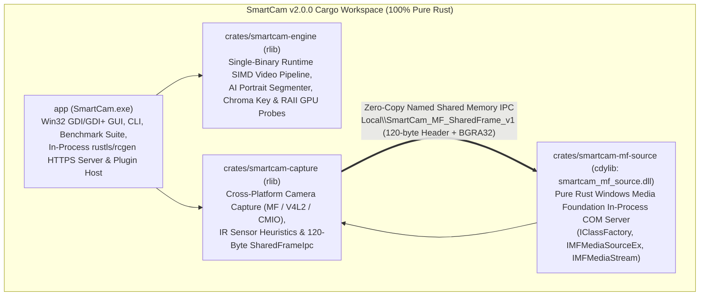

# SmartCam v2.0.0 — Technical Architecture & Engineering Guide

> **Document Scope:** This document provides an in-depth engineering reference for software architects, systems programmers, and contributors working on **SmartCam v2.0.0**. For end-user installation and usage instructions, see [`README.md`](../README.md) (English) or [`README.it.md`](../README.it.md) (Italian).

---

## 1. Architectural Overview & Cargo Workspace Topology

Starting with **v2.0.0**, SmartCam is a **100% Pure Rust** workspace. All legacy C++17 translation units, CMake/Ninja build scripts, C ABI bridge DLLs (`smartcam_engine.dll`, `smartcam_engine_avx2.dll`, `smartcam_engine_avx512.dll`, `smartcam_win_bridge.dll`), out-of-process PowerShell TLS relays, and legacy DirectShow filter graphs have been permanently eliminated.



### Workspace Crate Breakdown

| Crate | Path | Target Type | Responsibility |
| :--- | :--- | :--- | :--- |
| **`smartcam`** | [`app/`](../app/Cargo.toml) | `bin` (`SmartCam.exe` / `SmartCam`) | Native desktop UI, system tray lifecycle, hardware benchmark runner, YAML configuration management, in-process TLS smartphone camera receiver, and real-time pipeline orchestration. |
| **`smartcam-engine`** | [`crates/smartcam-engine/`](../crates/smartcam-engine/Cargo.toml) | `rlib` | Pure-Rust video processing engine: aspect-ratio crop/scaler, HSV green-screen chroma keyer with spill suppression, AI human portrait segmenter, separable box blur, alpha compositor, and RAII dynamic GPU/ONNX runtime probing. |
| **`smartcam-capture`** | [`crates/smartcam-capture/`](../crates/smartcam-capture/Cargo.toml) | `rlib` | Cross-platform hardware webcam capture (`IMFSourceReader` on Windows, `V4L2` on Linux, `CoreMediaIO` on macOS), infrared (Windows Hello IR) sensor filtering, and the lock-free seqlock `SharedFrameIpc` transport. |
| **`smartcam_mf_source`** | [`crates/smartcam-mf-source/`](../crates/smartcam-mf-source/Cargo.toml) | `cdylib`, `rlib` | Windows 10/11 Media Foundation In-Process COM Virtual Camera DLL (`smartcam_mf_source.dll`) built with `windows` and `windows-core` `#[implement]` macros. |

---

## 2. Pure Rust Video Pipeline & Runtime SIMD Dispatch

In v1.x, SmartCam compiled separate C++ shared libraries (`smartcam_engine_avx2.dll` and `smartcam_engine_avx512.dll`) and selected a DLL via `LoadLibraryW`. In **v2.0.0**, [`crates/smartcam-engine`](../crates/smartcam-engine/src/lib.rs) compiles all vector instruction sets into a **single unified binary** and dispatches hot loops dynamically at runtime.

### Runtime CPU Feature Detection

On `x86_64`, `smartcam_engine::detect_best_simd_tier()` inspects CPUID feature flags via `std::arch::is_x86_feature_detected!`:
1. **`SimdTier::Avx512`**: Selected when both `avx512f` and `avx512bw` are supported by the CPU and OS (`XCR0` ZMM state enabled).
2. **`SimdTier::Avx2`**: Selected when `avx2` is supported (256-bit YMM registers).
3. **`SimdTier::Neon`**: Selected automatically on `aarch64` targets (Apple Silicon / ARM64) using `core::arch::aarch64` intrinsics.
4. **`SimdTier::Scalar`**: Portable auto-vectorized Rust fallback guaranteed to run on any architecture.

### Hot-Loop Vector Kernels

Every frame passes through four deterministic stages inside [`crates/smartcam-engine`](../crates/smartcam-engine/src/lib.rs):

1. **Aspect-Ratio Crop & Bilinear/Nearest Scaler ([`crop_scaler.rs`](../crates/smartcam-engine/src/crop_scaler.rs))**:
   - Computes center-crop or letterbox geometry for `4:3`, `16:9`, `1:1`, and `9:16` output targets.
   - Uses `#[target_feature(enable = "avx2")]` and `#[target_feature(enable = "avx512f,avx512bw")]` row gather/copy routines to process 8 or 16 BGRA32 pixels per instruction cycle.
2. **Separable Box Blur & Background Generator ([`compositor.rs`](../crates/smartcam-engine/src/compositor.rs))**:
   - Implements an $O(1)$-per-pixel sliding-window horizontal + vertical separable box blur that is invariant to `blur_radius`.
   - Supports social pan/zoom/mirror background image caching and solid BGRA fill.
3. **Foreground Alpha Mask Segmentation ([`green_screen.rs`](../crates/smartcam-engine/src/green_screen.rs) & [`ai_segmenter.rs`](../crates/smartcam-engine/src/ai_segmenter.rs))**:
   - **Green Screen Mode**: Fast integer RGB-to-HSV conversion (`H: 0..180`, `S: 0..255`, `V: 0..255`), 3x3 morphological erosion/dilation, edge feathering, and green chroma spill suppression ($G' = \min(G, \frac{R + B}{2})$).
   - **AI Portrait Segmentation Mode**: Evaluates a 256x144 downsampled grid combining calibrated YCbCr skin-tone likelihood, 5-point facial landmark geometry, temporal EMA smoothing ($\alpha = 0.72$), Sobel edge-guided refinement, and optional reference-background differencing.
4. **Vectorized Alpha Compositing ([`compositor.rs`](../crates/smartcam-engine/src/compositor.rs))**:
   - Blends foreground $F$, background $B$, and 8-bit matte $M$ using exact 16-bit fixed-point arithmetic:
     $$\text{Out}_c = \frac{F_c \cdot M + B_c \cdot (255 - M) + 128}{255}$$
   - Dispatches dynamically across `blend_bgra_avx512`, `blend_bgra_avx2`, `blend_bgra_neon`, and `blend_bgra_scalar`. Unit tests in `crates/smartcam-engine` verify bit-exact equivalence (within $\pm 1$ LSB rounding tolerance) between Scalar, AVX2, and AVX-512 paths.

---

## 3. GPU & AI Segmentation Architecture (RAII Dynamic Loader)

To guarantee that `SmartCam.exe` starts on any machine—even systems without discrete GPUs or vendor drivers installed—[`crates/smartcam-engine/src/gpu.rs`](../crates/smartcam-engine/src/gpu.rs) never links statically against proprietary GPU SDKs.

Instead, it implements a safe RAII wrapper (`SafeLibrary`) around OS dynamic loader primitives (`LoadLibraryW` / `GetProcAddress` on Windows, `dlopen` / `dlsym` on Linux and macOS) with an automatic `Drop` implementation that invokes `FreeLibrary` / `dlclose`:

* **Vulkan (`vulkan-1.dll` / `libvulkan.so.1`)**: Resolves `vkCreateInstance` to probe Vulkan 1.x compute support.
* **OpenCL (`OpenCL.dll` / `libOpenCL.so.1`)**: Resolves `clGetPlatformIDs` to probe OpenCL ICD platforms.
* **NVIDIA CUDA (`nvcuda.dll` / `libcuda.so.1`)**: Resolves `cuInit` to probe NVIDIA Driver API availability.
* **AMD ROCm / HIP (`amdhip64.dll` / `libamdhip64.so`)**: Resolves `hipInit` to probe AMD HIP compute runtimes.
* **ONNX Runtime (`onnxruntime.dll` / `libonnxruntime.so`)**: Resolves `OrtGetApiBase` for optional external neural network execution providers while maintaining a built-in zero-dependency Rust heuristic/neural fallback.

---

## 4. In-Process Native HTTPS/WebSocket Server (`< 1 MB` RAM)

Modern mobile browsers (iOS Safari and Android Chrome) enforce a strict Secure Context requirement (`https://` or `wss://`) before exposing `navigator.mediaDevices.getUserMedia({ video: true })`.

In v1.x, SmartCam spawned an external `powershell.exe` + `.NET SslStream` child process that consumed ~45–60 MB of RAM. In **v2.0.0**, [`app/src/plugins.rs`](../app/src/plugins.rs) implements the entire HTTPS/WebSocket server **in-process in pure Rust**:

1. **On-the-Fly X.509 Certificate Generation (`rcgen`)**:
   - Generates a self-signed ECDSA/RSA X.509 certificate in memory at startup with Subject Alternative Names (SANs) covering `localhost`, `127.0.0.1`, and the host's active LAN IPv4 addresses.
2. **In-Process TLS Termination (`rustls`)**:
   - Wraps the non-blocking TCP listener (`0.0.0.0:<port>`) with `rustls::ServerConnection`.
   - Peek-multiplexes the first byte of each incoming TCP stream: if `0x16` (TLS Handshake ContentType `22`), the stream is terminated via `rustls::StreamOwned` and routed to the same HTTP/MJPEG/frame-upload handler; otherwise, plain HTTP requests on the same port are transparently redirected (`302 Found`) to `https://<LAN_IP>:<port>/`.
3. **Memory Footprint**:
   - Eliminates `powershell.exe` completely, reducing TLS server overhead to **under 1 MB of heap memory**.

---

## 5. Windows Media Foundation Virtual Camera COM Server (`smartcam_mf_source.dll`)

### Why DirectShow Was Deprecated in v2.0.0

In **SmartCam v2.0.0**, DirectShow (`IFilterMapper2` / `CLSID_VideoInputDeviceCategory` / `IAMStreamConfig`) has been **completely removed** in favor of an exclusive **Windows Media Foundation** architecture:
* Windows 10 and Windows 11 native camera pipelines (`FrameServer`), UWP applications, Microsoft Teams, Zoom, OBS Studio, and Chromium/Gecko browsers all consume video capture devices through Media Foundation (`IMFMediaSource` / `IMFActivate`).
* Removing legacy DirectShow filter graph plumbing eliminates 32-bit/64-bit filter merit conflicts, reduces the COM DLL attack surface, and allows the entire driver to be written in idiomatic, memory-safe Rust using the official Microsoft `windows` crate (`v0.58`).
* Users who require legacy DirectShow support on older systems can continue using the **v1.x** release branch.

### Idiomatic Rust COM Implementation (`#[implement]`)

[`crates/smartcam-mf-source`](../crates/smartcam-mf-source/src/lib.rs) compiles to `smartcam_mf_source.dll` (`crate-type = ["cdylib", "rlib"]`) and registers under CLSID `{9D4B8E71-3F5A-4E9C-A8B2-71C9D0E54F21}`:

* **[`factory.rs`](../crates/smartcam-mf-source/src/factory.rs)**: Implements `IClassFactory` (`CreateInstance`, `LockServer`) via `#[implement(IClassFactory)]`.
* **[`source.rs`](../crates/smartcam-mf-source/src/source.rs)**: Implements `IMFMediaSourceEx`, `IMFMediaSource`, `IMFMediaEventGenerator`, and `IMFGetService` via `#[implement(IMFMediaSourceEx, IMFMediaSource, IMFMediaEventGenerator, IMFGetService)]`. Configures `MF_VIRTUALCAMERA_PROVIDE_ASSOCIATED_CAMERA_SOURCES` and `MFMEDIASOURCE_IS_LIVE` attributes for Windows 11 FrameServer compatibility.
* **[`stream.rs`](../crates/smartcam-mf-source/src/stream.rs)**: Implements `IMFMediaStream` and `IMFMediaEventGenerator`, advertising both `MFVideoFormat_NV12` (studio-range BT.709 YUV 4:2:0 for hardware encoders and browsers) and `MFVideoFormat_RGB32` (`BGRA32`) media types, and delivering `MEMediaSample` events on `RequestSample`.
* **[`dll.rs`](../crates/smartcam-mf-source/src/dll.rs)**: Exports `DllMain`, `DllGetClassObject`, `DllCanUnloadNow`, `DllRegisterServer`, and `DllUnregisterServer`.

### Zero-Copy Shared Memory IPC Layout (`SharedFrameHeader` — 120 Bytes)

Both [`crates/smartcam-capture/src/header.rs`](../crates/smartcam-capture/src/header.rs) and [`crates/smartcam-mf-source`](../crates/smartcam-mf-source/src/lib.rs) share the exact `#[repr(C)]` 120-byte header in the named file mapping `Local\SmartCam_MF_SharedFrame_v1` (synchronized via `Local\SmartCam_MF_FrameEvent_v1`):

| Byte Offset | Size | Field | Type | Description |
| :--- | :--- | :--- | :--- | :--- |
| `0` | 4 B | `magic` | `u32` | Magic constant `0x534D434D` (`"SMCM"`). |
| `4` | 4 B | `version` | `u32` | Protocol version (`1`). |
| `8` | 8 B | `sequence_counter` | `AtomicI64` | Seqlock counter: **odd** while writer is copying, **even** when coherent. |
| `16` | 4 B | `width` | `u32` | Active frame width in pixels (up to `3840`). |
| `20` | 4 B | `height` | `u32` | Active frame height in pixels (up to `2160`). |
| `24` | 4 B | `stride` | `u32` | Row stride in bytes (`width * 4`). |
| `28` | 4 B | `fps_num` | `u32` | Frame rate numerator (e.g., `30` or `60`). |
| `32` | 4 B | `fps_den` | `u32` | Frame rate denominator (`1`). |
| `36` | 4 B | `pixel_format` | `u32` | `4 = BGRA32` (8-bit/channel), `8 = BGRA64` (16-bit/channel). |
| `40` | 8 B | `timestamp_100ns` | `u64` | Presentation timestamp in Media Foundation 100-ns ticks. |
| `48` | 8 B | `frame_index` | `u64` | Monotonically increasing frame counter. |
| `56` | 8 B | `last_consumer_heartbeat_ms` | `AtomicU64` | `GetTickCount64()` timestamp updated by `smartcam_mf_source.dll` when active. |
| `64` | 4 B | `consumer_requests` | `AtomicU32` | Total `RequestSample` calls served by the Media Foundation stream. |
| `68` | 4 B | `_pad` | `u32` | Explicit 8-byte alignment padding. |
| `72` | 48 B | `reserved` | `[u8; 48]` | Reserved for future metadata extensions. |
| **`120`** | **33.17 MB** | **`payload`** | **`[u8]`** | **Contiguous pixel buffer (`3840 * 2160 * 4` bytes max).** |

---

## 6. Build Instructions, CI/CD & Code Signing

### Building & Testing from Source

SmartCam v2.0.0 requires only the standard **Rust stable toolchain** (`cargo` / `rustc` $\ge 1.80$):

```powershell
# 1. Check and compile the entire workspace in Release mode
cargo build --release --workspace

# 2. Run all unit & integration tests (SIMD parity, TLS handshake, COM & IPC ABI)
cargo test --release --workspace

# 3. Run code formatting & static analysis checks
cargo fmt --all -- --check
cargo clippy --workspace -- -D warnings
```

### Local Code Signing (`.certs/`) & Inno Setup Packaging

Code signing certificates are stored locally in the git-ignored `.certs/` directory (and mirrored to GitHub Actions Secrets `WINDOWS_PFX_BASE64` and `WINDOWS_PFX_PASSWORD`):
* `.certs/smartcam_private.key` — RSA-4096 PEM private key (`CN=Rubens Rainelli, O=Rubens Rainelli`).
* `.certs/smartcam_publisher.cer` — X.509 DER public certificate (`EKU=1.3.6.1.5.5.7.3.3` Code Signing).
* `.certs/smartcam_codesign.pfx` — PKCS#12 archive protected by `.certs/password.txt`.

To sign the release binaries and build the Windows installer (`SmartCam-Setup-v2.0.0-x64.exe`) locally:

```powershell
$pwd = (Get-Content .certs\password.txt -Raw).Trim()
signtool.exe sign /f .certs\smartcam_codesign.pfx /p $pwd /fd SHA256 /tr http://timestamp.digicert.com /td SHA256 target\release\SmartCam.exe
signtool.exe sign /f .certs\smartcam_codesign.pfx /p $pwd /fd SHA256 /tr http://timestamp.digicert.com /td SHA256 target\release\smartcam_mf_source.dll
iscc platforms\windows\installer\smartcam.iss
signtool.exe sign /f .certs\smartcam_codesign.pfx /p $pwd /fd SHA256 /tr http://timestamp.digicert.com /td SHA256 dist\SmartCam-Setup-v2.0.0-x64.exe
```

### Automated Multi-Platform CI/CD Pipeline

The GitHub Actions workflow [`.github/workflows/release.yml`](../.github/workflows/release.yml) runs on every `v*` tag and builds:
1. **Windows (`windows-latest`)**: Compiles `SmartCam.exe` and `smartcam_mf_source.dll`, signs both with `signtool.exe`, compiles `SmartCam-Setup-v2.0.0-x64.exe` via Inno Setup, signs the installer, and packages `SmartCam-v2.0.0-windows-x64-portable.zip`.
2. **Linux (`ubuntu-latest`)**: Compiles `SmartCam` and packages `SmartCam-v2.0.0-linux-x86_64.tar.gz` and `smartcam_2.0.0_amd64.deb`.
3. **macOS (`macos-latest`)**: Cross-compiles `x86_64-apple-darwin` and `aarch64-apple-darwin`, merges them via `lipo -create` into a Universal `SmartCam.app` bundle, signs with `codesign --force --deep --sign -`, and packages `SmartCam-v2.0.0-macos-universal.dmg`.
4. **Release Publication**: Computes `SHA256SUMS.txt` across all release assets and publishes them to the GitHub Release page.
